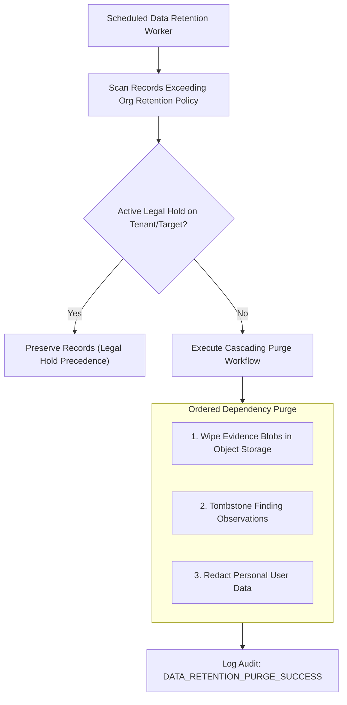

# P4-41 — Implement Enterprise Data Retention and Deletion Controls

**Parent Epic:** [Phase 4 — Enterprise Platform, Security & Scalability](../MILESTONE_PHASE_4.md)  
**Milestone:** [Phase 4 — Enterprise Platform, Security & Scalability](../MILESTONE_PHASE_4.md)  
**Workstream:** Workstream E — Governance, Scalability & Platform Controls  
**Status:** `ready-for-dev`  

---

## 🎯 Purpose

Extend Phase 1 and Phase 3 data lifecycle capabilities into organization-level governance while preserving mandatory platform controls.

---

## 📐 Architecture & Workflow Diagram

---

## 📋 Detailed Requirements

- Define retention controls for applicable data categories.
- Support organization-level settings within platform-enforced limits.
- Define retention behavior for: Assessments, Findings and observations, Evidence, Reports, Integration records, Audit data.
- Define how retention interacts with legal, security, and operational requirements (Legal Hold support).
- Support approved deletion or archival workflows.
- Ensure references and dependent objects are handled consistently.
- Prevent deletion of records protected by mandatory retention requirements.
- Record lifecycle-policy changes and execution outcomes.
- Define how retention-policy changes affect existing records.

---

## 🛡️ Security & Architectural Invariants

- **Enterprise Multi-Tenancy:** Multi-organization and workspace hierarchy must never bypass or compromise the core tenant isolation boundaries established in ADR-0002.
- **Principle of Least Privilege:** RBAC/ABAC policy engines and service identity delegation must deny access by default and explicitly enforce permission scopes.
- **Tamper-Evident Auditability:** All administrative actions, SSO events, policy alterations, secret accesses, and integration invocations must emit structured, immutable audit log events.
- **Fail-Safe Operation:** Quotas, rate limits, distributed queue failovers, and webhook dispatchers must degrade gracefully without data loss, deadlocks, or silent failures.

---

## ✅ Acceptance Criteria

- [ ] Data categories have documented retention rules.
- [ ] Organization settings cannot override mandatory platform controls.
- [ ] Deletion and archival behavior is deterministic.
- [ ] Dependencies and evidence references are handled correctly.
- [ ] Lifecycle operations are auditable and tested.

---

## 🔗 Related Documentation & Links

- Enterprise Architecture Baseline: [`docs/architecture/SYSTEM_ARCHITECTURE.md`](../../../docs/architecture/SYSTEM_ARCHITECTURE.md)
- Multi-Tenancy & Isolation Model: [`docs/architecture/TENANT_ISOLATION.md`](../../../docs/architecture/TENANT_ISOLATION.md)
- Security Policies & Auditing: [`docs/security/AUDIT_SPECIFICATION.md`](../../../docs/security/AUDIT_SPECIFICATION.md)
- API & Webhook Specifications: [`docs/api/API_SPECIFICATION.md`](../../../docs/api/API_SPECIFICATION.md)
