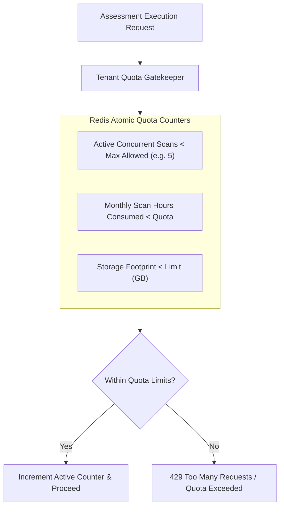

# P4-42 — Implement Tenant Usage Metering and Quota Enforcement

**Parent Epic:** [Phase 4 — Enterprise Platform, Security & Scalability](../MILESTONE_PHASE_4.md)  
**Milestone:** [Phase 4 — Enterprise Platform, Security & Scalability](../MILESTONE_PHASE_4.md)  
**Workstream:** Workstream E — Governance, Scalability & Platform Controls  
**Status:** `ready-for-dev`  

---

## 🎯 Purpose

Provide measurable resource usage and fair limits across enterprise organizations and workspaces.

---

## 📐 Architecture & Workflow Diagram

---

## 📋 Detailed Requirements

- Define measurable usage dimensions: Active users, Active service identities, Assessments submitted, Concurrent assessments, Scanner execution time (compute hours), Evidence storage (GB), Report generation, Integration event volume.
- Define usage accounting semantics.
- Distinguish usage measurement from commercial billing.
- Support organization and workspace quotas.
- Enforce quotas at the application and execution boundaries.
- Define behavior when a quota is reached.
- Prevent race conditions in concurrent quota consumption using atomic Redis counters.
- Record usage changes with relevant source references.
- Expose authorized usage summaries.

---

## 🛡️ Security & Architectural Invariants

- **Enterprise Multi-Tenancy:** Multi-organization and workspace hierarchy must never bypass or compromise the core tenant isolation boundaries established in ADR-0002.
- **Principle of Least Privilege:** RBAC/ABAC policy engines and service identity delegation must deny access by default and explicitly enforce permission scopes.
- **Tamper-Evident Auditability:** All administrative actions, SSO events, policy alterations, secret accesses, and integration invocations must emit structured, immutable audit log events.
- **Fail-Safe Operation:** Quotas, rate limits, distributed queue failovers, and webhook dispatchers must degrade gracefully without data loss, deadlocks, or silent failures.

---

## ✅ Acceptance Criteria

- [ ] Usage dimensions are documented.
- [ ] Metering is consistent and tenant-scoped.
- [ ] Quotas are enforced.
- [ ] Concurrent usage updates do not bypass limits.
- [ ] Quota exhaustion produces predictable behavior.
- [ ] Tests cover boundary and concurrency conditions.

---

## 🔗 Related Documentation & Links

- Enterprise Architecture Baseline: [`docs/architecture/SYSTEM_ARCHITECTURE.md`](../../../docs/architecture/SYSTEM_ARCHITECTURE.md)
- Multi-Tenancy & Isolation Model: [`docs/architecture/TENANT_ISOLATION.md`](../../../docs/architecture/TENANT_ISOLATION.md)
- Security Policies & Auditing: [`docs/security/AUDIT_SPECIFICATION.md`](../../../docs/security/AUDIT_SPECIFICATION.md)
- API & Webhook Specifications: [`docs/api/API_SPECIFICATION.md`](../../../docs/api/API_SPECIFICATION.md)
