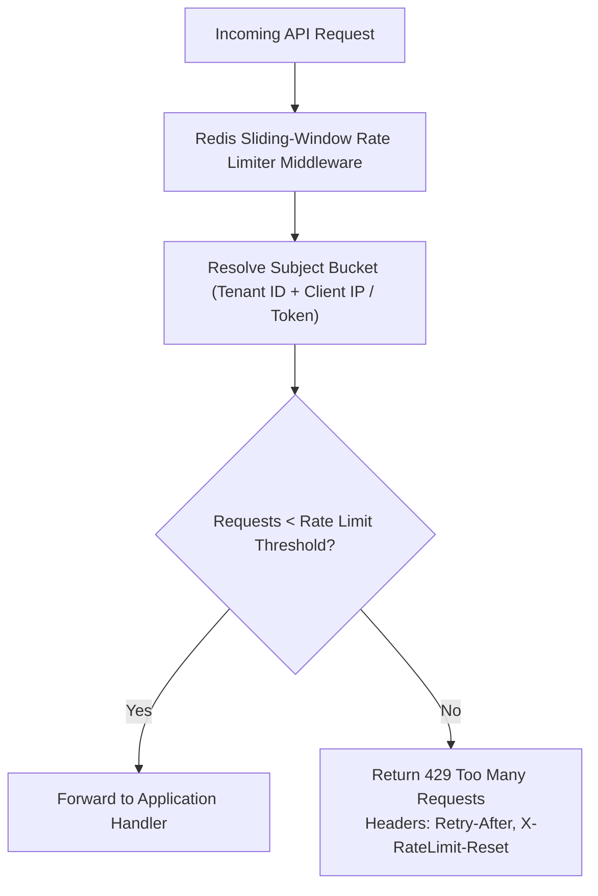

# P4-43 — Implement API Rate Limiting and Fair-Use Controls

**Parent Epic:** [Phase 4 — Enterprise Platform, Security & Scalability](../MILESTONE_PHASE_4.md)  
**Milestone:** [Phase 4 — Enterprise Platform, Security & Scalability](../MILESTONE_PHASE_4.md)  
**Workstream:** Workstream E — Governance, Scalability & Platform Controls  
**Status:** `ready-for-dev`  

---

## 🎯 Purpose

Protect the platform from abusive or excessively expensive API usage while ensuring fair resource allocation across organizations.

---

## 📐 Architecture & Workflow Diagram

---

## 📋 Detailed Requirements

- Define rate-limit policies for public and internal API operations.
- Support organization-level, user-level, and service-identity limits where required.
- Define separate controls for expensive operations: Assessment creation, Bulk triage, Report generation, Evidence retrieval, Search and aggregation, Integration event delivery.
- Use a distributed rate-limit strategy (Redis Token Bucket / Sliding Window).
- Define rate-limit response semantics (RFC 6585 429 Too Many Requests + Retry-After).
- Prevent spoofed tenant context from influencing rate-limit ownership.
- Ensure privileged internal operations have explicit, controlled policies.
- Add metrics for rejected or throttled requests.
- Prevent rate-limit state from becoming a cross-tenant information leak.

---

## 🛡️ Security & Architectural Invariants

- **Enterprise Multi-Tenancy:** Multi-organization and workspace hierarchy must never bypass or compromise the core tenant isolation boundaries established in ADR-0002.
- **Principle of Least Privilege:** RBAC/ABAC policy engines and service identity delegation must deny access by default and explicitly enforce permission scopes.
- **Tamper-Evident Auditability:** All administrative actions, SSO events, policy alterations, secret accesses, and integration invocations must emit structured, immutable audit log events.
- **Fail-Safe Operation:** Quotas, rate limits, distributed queue failovers, and webhook dispatchers must degrade gracefully without data loss, deadlocks, or silent failures.

---

## ✅ Acceptance Criteria

- [ ] Rate limits are enforced consistently across application instances.
- [ ] Tenant and service-identity attribution is trusted.
- [ ] Expensive operations have appropriate controls.
- [ ] Clients receive standardized rate-limit responses.
- [ ] Distributed concurrency tests verify correct behavior.

---

## 🔗 Related Documentation & Links

- Enterprise Architecture Baseline: [`docs/architecture/SYSTEM_ARCHITECTURE.md`](../../../docs/architecture/SYSTEM_ARCHITECTURE.md)
- Multi-Tenancy & Isolation Model: [`docs/architecture/TENANT_ISOLATION.md`](../../../docs/architecture/TENANT_ISOLATION.md)
- Security Policies & Auditing: [`docs/security/AUDIT_SPECIFICATION.md`](../../../docs/security/AUDIT_SPECIFICATION.md)
- API & Webhook Specifications: [`docs/api/API_SPECIFICATION.md`](../../../docs/api/API_SPECIFICATION.md)
