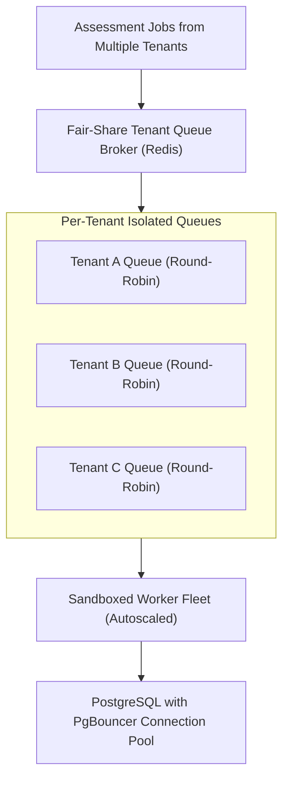

# P4-44 — Implement Enterprise Workload Isolation and Scalability Controls

**Parent Epic:** [Phase 4 — Enterprise Platform, Security & Scalability](../MILESTONE_PHASE_4.md)  
**Milestone:** [Phase 4 — Enterprise Platform, Security & Scalability](../MILESTONE_PHASE_4.md)  
**Workstream:** Workstream E — Governance, Scalability & Platform Controls  
**Status:** `ready-for-dev`  

---

## 🎯 Purpose

Improve KELVIN's ability to handle larger organizations and increased assessment volume without allowing one tenant to monopolize shared resources.

---

## 📐 Architecture & Workflow Diagram

---

## 📋 Detailed Requirements

- Review application bottlenecks across API, queue, worker, database, evidence storage, and integrations.
- Define service and workload isolation boundaries.
- Implement fair queue scheduling (Fair-share round-robin across tenant queues).
- Support tenant-aware worker capacity allocation.
- Identify components that need independent scaling.
- Ensure long-running assessment workloads do not degrade interactive API operations.
- Define backpressure behavior when downstream services are saturated.
- Review database query patterns and connection-pool usage (PgBouncer).
- Review object-storage throughput and access patterns.
- Add relevant performance and saturation metrics.
- Preserve all existing tenant and worker security boundaries.

---

## 🛡️ Security & Architectural Invariants

- **Enterprise Multi-Tenancy:** Multi-organization and workspace hierarchy must never bypass or compromise the core tenant isolation boundaries established in ADR-0002.
- **Principle of Least Privilege:** RBAC/ABAC policy engines and service identity delegation must deny access by default and explicitly enforce permission scopes.
- **Tamper-Evident Auditability:** All administrative actions, SSO events, policy alterations, secret accesses, and integration invocations must emit structured, immutable audit log events.
- **Fail-Safe Operation:** Quotas, rate limits, distributed queue failovers, and webhook dispatchers must degrade gracefully without data loss, deadlocks, or silent failures.

---

## ✅ Acceptance Criteria

- [ ] A scalability architecture and bottleneck assessment exist.
- [ ] Workload isolation and fairness controls are implemented where required.
- [ ] Interactive requests are protected from heavy background workloads.
- [ ] Backpressure is defined and tested.
- [ ] Tenant isolation is maintained under concurrent load.
- [ ] Architectural decisions are documented.

---

## 🔗 Related Documentation & Links

- Enterprise Architecture Baseline: [`docs/architecture/SYSTEM_ARCHITECTURE.md`](../../../docs/architecture/SYSTEM_ARCHITECTURE.md)
- Multi-Tenancy & Isolation Model: [`docs/architecture/TENANT_ISOLATION.md`](../../../docs/architecture/TENANT_ISOLATION.md)
- Security Policies & Auditing: [`docs/security/AUDIT_SPECIFICATION.md`](../../../docs/security/AUDIT_SPECIFICATION.md)
- API & Webhook Specifications: [`docs/api/API_SPECIFICATION.md`](../../../docs/api/API_SPECIFICATION.md)
