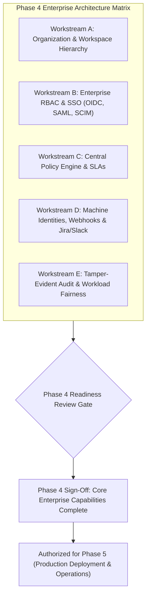

# P4-45 — Complete Enterprise Feature Integration and Phase 4 Readiness Review

**Parent Epic:** [Phase 4 — Enterprise Platform, Security & Scalability](../MILESTONE_PHASE_4.md)  
**Milestone:** [Phase 4 — Enterprise Platform, Security & Scalability](../MILESTONE_PHASE_4.md)  
**Workstream:** Workstream E — Governance, Scalability & Platform Controls  
**Status:** `ready-for-dev`  

---

## 🎯 Purpose

Verify that enterprise organization management, identity, policies, integrations, governance, and scalability work together without breaking the core assessment and findings platform.

---

## 📐 Architecture & Workflow Diagram

---

## 📋 Detailed Requirements

- Verify organization and workspace boundaries, memberships, and team administration.
- Verify built-in and custom roles, and object-level authorization.
- Verify OIDC, SAML, and SCIM 2.0 provisioning flows.
- Verify policy enforcement across assessment creation, scheduling, SLAs, and exceptions.
- Verify service identities, OAuth client credentials, and API key management.
- Verify signed webhooks and Jira/collaboration integrations.
- Verify tamper-evident audit integrity, retention controls, and data exports.
- Verify tenant usage quotas, distributed rate limiting, and workload fairness under load.
- Publish Phase 4 Enterprise Architecture and Readiness Report.

---

## 🛡️ Security & Architectural Invariants

- **Enterprise Multi-Tenancy:** Multi-organization and workspace hierarchy must never bypass or compromise the core tenant isolation boundaries established in ADR-0002.
- **Principle of Least Privilege:** RBAC/ABAC policy engines and service identity delegation must deny access by default and explicitly enforce permission scopes.
- **Tamper-Evident Auditability:** All administrative actions, SSO events, policy alterations, secret accesses, and integration invocations must emit structured, immutable audit log events.
- **Fail-Safe Operation:** Quotas, rate limits, distributed queue failovers, and webhook dispatchers must degrade gracefully without data loss, deadlocks, or silent failures.

---

## ✅ Acceptance Criteria

- [ ] Enterprise features integrate with the existing Phase 1–3 architecture.
- [ ] Organization and tenant authorization tests pass.
- [ ] SSO and provisioning security tests pass.
- [ ] Policy enforcement is consistent across execution boundaries.
- [ ] API credentials and integration secrets are protected.
- [ ] Webhook and notification failures do not destabilize core application workflows.
- [ ] Audit, export, and retention controls are verified.
- [ ] Quotas and rate limits behave correctly under concurrency.
- [ ] No unresolved critical Phase 4 security defects remain without an approved risk decision.
- [ ] A Phase 4 architecture and readiness report is reviewed and approved.

---

## 🔗 Related Documentation & Links

- Enterprise Architecture Baseline: [`docs/architecture/SYSTEM_ARCHITECTURE.md`](../../../docs/architecture/SYSTEM_ARCHITECTURE.md)
- Multi-Tenancy & Isolation Model: [`docs/architecture/TENANT_ISOLATION.md`](../../../docs/architecture/TENANT_ISOLATION.md)
- Security Policies & Auditing: [`docs/security/AUDIT_SPECIFICATION.md`](../../../docs/security/AUDIT_SPECIFICATION.md)
- API & Webhook Specifications: [`docs/api/API_SPECIFICATION.md`](../../../docs/api/API_SPECIFICATION.md)
