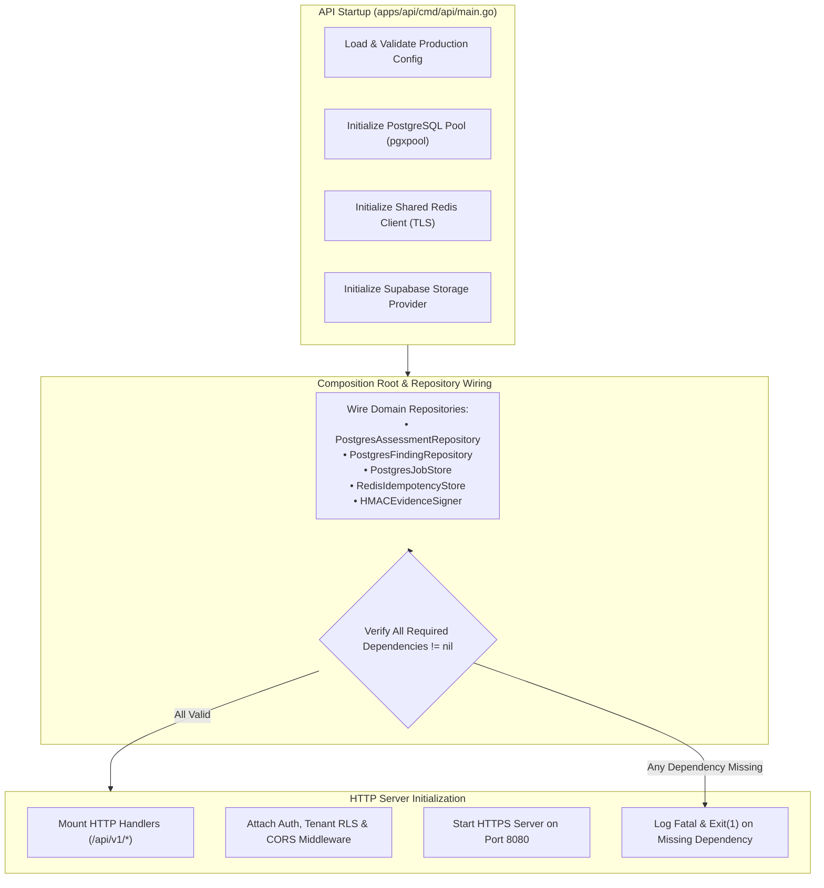

# PRE-02 — API Composition and Repository Wiring

**Parent Epic:** [PRE-DEPLOY-EPIC: KELVIN Pre-Deployment Engineering Hardening](PRE-DEPLOY-EPIC_KELVIN_PRE_DEPLOYMENT_ENGINEERING_HARDENING.md) (Parent Epic #464)  
**Milestone:** [Pre-Deployment Production Hardening](../MILESTONE_PRE_DEPLOYMENT.md)  
**Issue ID:** `PRE-02`  
**Priority:** `critical` (Deployment-blocking)  
**Status:** `completed`  
**Target Pull Request:** `fix(api): implement application composition root and repository wiring`  

---

## 🎯 Purpose

Implement a complete production application composition root in apps/api/cmd/api/main.go, wiring real PostgreSQL repositories, findings stores, job stores, and storage providers with fail-fast startup checks.

---

## 📐 Architecture & Workflow Diagram

---

## 📋 Detailed Requirements

- Implement production composition root in apps/api/cmd/api/main.go, replacing uninitialized stores with real implementations.
- Inject PostgresFindingRepository, PostgresAssessmentRepository, and job store into the HTTP router.
- Complete PostgresFindingRepository methods required by the HTTP API findings interface, eliminating partial or stubbed methods.
- Inject RedisIdempotencyStore for assessment creation deduplication.
- Inject SupabaseStorageProvider and HMACEvidenceSigner for report and evidence handling.
- Implement strict fail-fast validation: refuse to start in production if any mandatory service or repository is nil.
- Add integration tests verifying end-to-end persistence for assessments, findings, and job state transitions.

---

## 🛡️ Security & Architectural Invariants

- **Mandatory Fail-Closed:** Any missing security context, tenant identifier, or cryptographic key must fail closed and refuse execution.
- **Strict Tenant Scoping:** All operations must resolve tenant context through canonical `current_tenant_id()` with RLS enforced.
- **Zero Insecure Fallbacks:** Remove all production fallback mechanisms that weaken security (e.g. `sslmode=disable`, hardcoded signing keys, nil repositories).
- **Resource Limits & Least Privilege:** Containers and database pools must be bounded to protect the 1 OCPU / 6 GB Oracle environment.

---

## ✅ Acceptance Criteria

- [x] All API routes are backed by persistent PostgreSQL and Redis stores with zero nil-pointer panics.
- [x] No fake or mock repositories are active in production builds.
- [x] Missing environment configuration or database failure causes immediate graceful fatal shutdown at boot.
- [x] Integration tests confirm assessment creation, finding retrieval, and job status updates persist to PostgreSQL.

---

## 🔗 Related Documentation & Links

- Parent Pre-Deployment Epic: [`PRE-DEPLOY-EPIC_KELVIN_PRE_DEPLOYMENT_ENGINEERING_HARDENING.md`](PRE-DEPLOY-EPIC_KELVIN_PRE_DEPLOYMENT_ENGINEERING_HARDENING.md)
- Control Plane API: [`apps/api/`](../../../../apps/api/)
- Worker Runtime: [`apps/worker/`](../../../../apps/worker/)
- Deployment Guides: [`docs/deployment/`](../../../../docs/deployment/)
