# PRE-03 — Redis TLS and Idempotency Integration

**Parent Epic:** [PRE-DEPLOY-EPIC: KELVIN Pre-Deployment Engineering Hardening](PRE-DEPLOY-EPIC_KELVIN_PRE_DEPLOYMENT_ENGINEERING_HARDENING.md) (Parent Epic #464)  
**Milestone:** [Pre-Deployment Production Hardening](../MILESTONE_PRE_DEPLOYMENT.md)  
**Issue ID:** `PRE-03`  
**Priority:** `critical` (Deployment-blocking)  
**Status:** `ready-for-dev`  
**Target Pull Request:** `fix(redis): enforce tls connection and tenant scoped idempotency`  

---

## 🎯 Purpose

Standardize all Redis connectivity in API and worker onto the shared packages/common/redis client, enforcing TLS (rediss://), authentication, bounded connection pools, and tenant-scoped keys.

---

## 📐 Architecture & Workflow Diagram

```mermaid
flowchart LR
    subgraph Clients ["Application Runtimes"]
        API["Go Control Plane API (Pool: 3-5 conns)"]
        Worker["Go Scanner Worker (Pool: 2-3 conns)"]
    end

    subgraph SharedClient ["packages/common/redis/client.go"]
        TLSConfig["TLS Config (rediss:// with ServerName verification)"]
        AuthHandler["Username & Password Auth"]
        PoolManager["Bounded Pool Sizing & Dial Timeouts"]
        HealthProbe["Liveness & Readiness PING Probes"]
    end

    subgraph Namespaces ["Tenant-Isolated Redis Key Namespaces"]
        Q["kelvin:queue:{workstream}"]
        H["kelvin:heartbeat:{worker_id}"]
        I["kelvin:idempotency:{tenant_id}:{idempotency_key}"]
        C["kelvin:cache:{tenant_id}:{resource_key}"]
    end

    subgraph RedisServer ["Managed Cloud Redis 7+"]
        Server["TLS Port 6379 / 6380"]
    end

    Clients --> SharedClient
    SharedClient --> Namespaces
    Namespaces --> Server
```

---

## 📋 Detailed Requirements

- Standardize API and worker entrypoints to use packages/common/redis/client.go instead of constructing basic raw clients.
- Enforce TLS (rediss:// scheme) with proper CA certificate validation and ServerName verification in production.
- Support username and password authentication from REDIS_URL and standalone environment variables.
- Configure conservative connection pools for constrained 1 OCPU / 6 GB Oracle VM: 3–5 connections for API, 2–3 for worker.
- Enforce tenant-isolated key namespacing: kelvin:idempotency:{tenant_id}:{key} and kelvin:cache:{tenant_id}:{key}.
- Implement bounded retry, dial timeouts (5s), read/write timeouts (3s), and graceful connection pool draining on SIGTERM.
- Add automated unit and integration tests verifying TLS connection, authentication failure, and cross-tenant key isolation.

---

## 🛡️ Security & Architectural Invariants

- **Mandatory Fail-Closed:** Any missing security context, tenant identifier, or cryptographic key must fail closed and refuse execution.
- **Strict Tenant Scoping:** All operations must resolve tenant context through canonical `current_tenant_id()` with RLS enforced.
- **Zero Insecure Fallbacks:** Remove all production fallback mechanisms that weaken security (e.g. `sslmode=disable`, hardcoded signing keys, nil repositories).
- **Resource Limits & Least Privilege:** Containers and database pools must be bounded to protect the 1 OCPU / 6 GB Oracle environment.

---

## ✅ Acceptance Criteria

- [ ] API and worker connect cleanly to Redis over TLS with zero plaintext socket leaks.
- [ ] Invalid Redis credentials fail gracefully without hanging startup.
- [ ] Duplicate assessment submissions within idempotency TTL are rejected.
- [ ] Tenant-owned keys cannot collide across different tenant environments.

---

## 🔗 Related Documentation & Links

- Parent Pre-Deployment Epic: [`PRE-DEPLOY-EPIC_KELVIN_PRE_DEPLOYMENT_ENGINEERING_HARDENING.md`](PRE-DEPLOY-EPIC_KELVIN_PRE_DEPLOYMENT_ENGINEERING_HARDENING.md)
- Control Plane API: [`apps/api/`](../../../../apps/api/)
- Worker Runtime: [`apps/worker/`](../../../../apps/worker/)
- Deployment Guides: [`docs/deployment/`](../../../../docs/deployment/)
