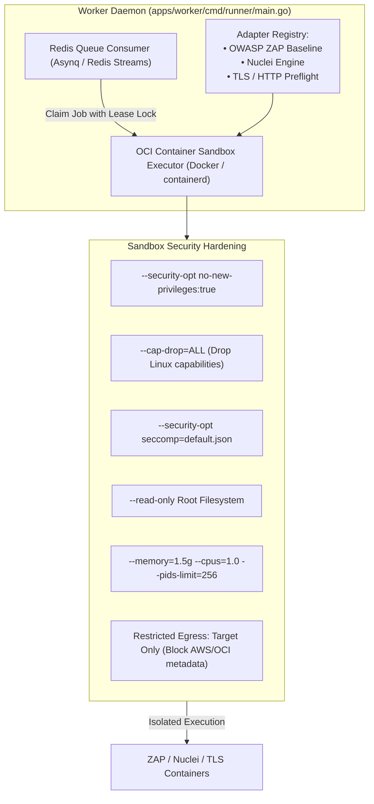

# PRE-04 — Worker Queue and Scanner Adapter Registration

**Parent Epic:** [PRE-DEPLOY-EPIC: KELVIN Pre-Deployment Engineering Hardening](PRE-DEPLOY-EPIC_KELVIN_PRE_DEPLOYMENT_ENGINEERING_HARDENING.md) (Parent Epic #464)  
**Milestone:** [Pre-Deployment Production Hardening](../MILESTONE_PRE_DEPLOYMENT.md)  
**Issue ID:** `PRE-04`  
**Priority:** `critical` (Deployment-blocking)  
**Status:** `completed`  
**Target Pull Request:** `fix(worker): register scanner adapters and wire redis queue`  

---

## 🎯 Purpose

Transform the worker runtime into a functioning production daemon by registering real scanner adapters (ZAP, Nuclei, TLS), replacing NopQueue with the Redis queue, and enforcing OCI sandbox isolation.

---

## 📐 Architecture & Workflow Diagram

---

## 📋 Detailed Requirements

- Register supported scanner adapters (OWASP ZAP baseline, Nuclei, and TLS preflight) in the worker adapter registry in apps/worker/cmd/runner/main.go.
- Replace NopQueue with the real Redis-backed queue consumer.
- Wire job heartbeat and execution lifecycle updates to PostgreSQL.
- Configure OCI container sandbox executor with strict security profiles: drop ALL capabilities, enable no-new-privileges, enforce seccomp, and mount read-only filesystems.
- Pin scanner container images by immutable digest (deploy/scanner-image-lock.yaml) and ensure ARM64 compatibility.
- Enforce egress network policy: permit outbound traffic only to authorized target IPs/domains; block cloud metadata endpoints (169.254.169.254) and internal services.
- Set worker concurrency = 1 for the 1 OCPU / 6 GB Oracle environment with memory ceiling of 1.5 GB per scanner job.
- Ensure the host Docker socket is never exposed to the API container.

---

## 🛡️ Security & Architectural Invariants

- **Mandatory Fail-Closed:** Any missing security context, tenant identifier, or cryptographic key must fail closed and refuse execution.
- **Strict Tenant Scoping:** All operations must resolve tenant context through canonical `current_tenant_id()` with RLS enforced.
- **Zero Insecure Fallbacks:** Remove all production fallback mechanisms that weaken security (e.g. `sslmode=disable`, hardcoded signing keys, nil repositories).
- **Resource Limits & Least Privilege:** Containers and database pools must be bounded to protect the 1 OCPU / 6 GB Oracle environment.

---

## ✅ Acceptance Criteria

- [x] Worker boots with real adapters registered and begins polling Redis queue.
- [x] Worker claims queued assessment, executes scanners inside isolated OCI sandboxes, and updates job state.
- [x] Scanners cannot elevate privileges or access local cloud metadata endpoints.
- [x] Worker gracefully drains active jobs on SIGTERM without leaving orphaned containers.

---

## 🔗 Related Documentation & Links

- Parent Pre-Deployment Epic: [`PRE-DEPLOY-EPIC_KELVIN_PRE_DEPLOYMENT_ENGINEERING_HARDENING.md`](PRE-DEPLOY-EPIC_KELVIN_PRE_DEPLOYMENT_ENGINEERING_HARDENING.md)
- Control Plane API: [`apps/api/`](../../../../apps/api/)
- Worker Runtime: [`apps/worker/`](../../../../apps/worker/)
- Deployment Guides: [`docs/deployment/`](../../../../docs/deployment/)
