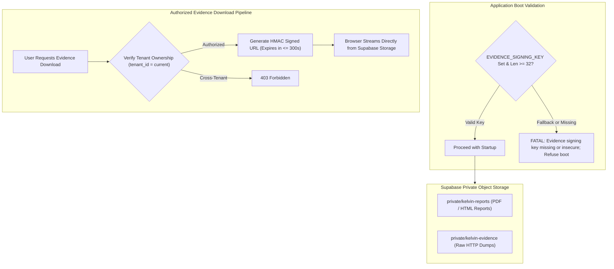

# PRE-05 — Evidence Security and Supabase Storage

**Parent Epic:** [PRE-DEPLOY-EPIC: KELVIN Pre-Deployment Engineering Hardening](PRE-DEPLOY-EPIC_KELVIN_PRE_DEPLOYMENT_ENGINEERING_HARDENING.md) (Parent Epic #464)  
**Milestone:** [Pre-Deployment Production Hardening](../MILESTONE_PRE_DEPLOYMENT.md)  
**Issue ID:** `PRE-05`  
**Priority:** `critical` (Deployment-blocking)  
**Status:** `ready-for-dev`  
**Target Pull Request:** `fix(security): remove evidence fallback key and wire supabase storage`  

---

## 🎯 Purpose

Eliminate the hardcoded fallback evidence signing key, enforce strong cryptographic production signing keys, wire private Supabase Storage buckets, and implement short-lived signed download URLs.

---

## 📐 Architecture & Workflow Diagram

---

## 📋 Detailed Requirements

- Remove the hardcoded fallback signing key (kelvin-default-evidence-signing-key-32-bytes) from evidence signing logic.
- Implement startup validation requiring EVIDENCE_SIGNING_KEY to be set with at least 32 cryptographically random bytes in production.
- Wire the Supabase Storage provider into the API composition root, configuring private buckets: kelvin-reports and kelvin-evidence.
- Enforce tenant-isolated object keys: {tenant_id}/{assessment_id}/{artifact_id}.
- Generate short-lived (max 300 seconds), cryptographically signed URLs for authorized report and evidence downloads.
- Validate uploaded file MIME types, magic numbers, and maximum size bounds (max 50 MB) before storage.
- Ensure the Supabase service-role key remains strictly on the backend and is never sent to the browser or logged.
- Add automated security tests verifying anonymous access denial, cross-tenant download rejection, and expired URL invalidation.

---

## 🛡️ Security & Architectural Invariants

- **Mandatory Fail-Closed:** Any missing security context, tenant identifier, or cryptographic key must fail closed and refuse execution.
- **Strict Tenant Scoping:** All operations must resolve tenant context through canonical `current_tenant_id()` with RLS enforced.
- **Zero Insecure Fallbacks:** Remove all production fallback mechanisms that weaken security (e.g. `sslmode=disable`, hardcoded signing keys, nil repositories).
- **Resource Limits & Least Privilege:** Containers and database pools must be bounded to protect the 1 OCPU / 6 GB Oracle environment.

---

## ✅ Acceptance Criteria

- [ ] API refuses to start in production when EVIDENCE_SIGNING_KEY is absent or default fallback is used.
- [ ] All reports and evidence are stored in private Supabase buckets with zero public access.
- [ ] Tenant A cannot generate signed URLs or access evidence objects owned by Tenant B.
- [ ] Signed URLs expire strictly after the configured TTL and cannot be reused or manipulated.

---

## 🔗 Related Documentation & Links

- Parent Pre-Deployment Epic: [`PRE-DEPLOY-EPIC_KELVIN_PRE_DEPLOYMENT_ENGINEERING_HARDENING.md`](PRE-DEPLOY-EPIC_KELVIN_PRE_DEPLOYMENT_ENGINEERING_HARDENING.md)
- Control Plane API: [`apps/api/`](../../../../apps/api/)
- Worker Runtime: [`apps/worker/`](../../../../apps/worker/)
- Deployment Guides: [`docs/deployment/`](../../../../docs/deployment/)
