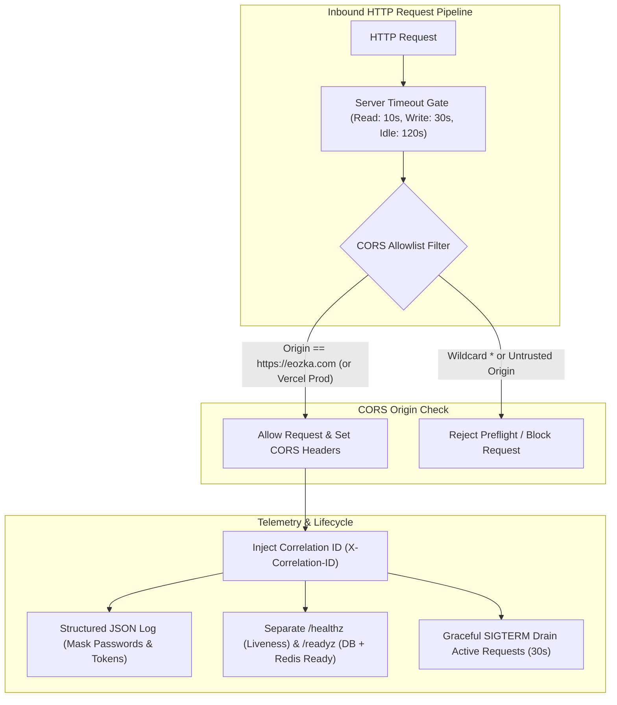

# PRE-06 — Production Configuration, CORS and Observability

**Parent Epic:** [PRE-DEPLOY-EPIC: KELVIN Pre-Deployment Engineering Hardening](PRE-DEPLOY-EPIC_KELVIN_PRE_DEPLOYMENT_ENGINEERING_HARDENING.md) (Parent Epic #464)  
**Milestone:** [Pre-Deployment Production Hardening](../MILESTONE_PRE_DEPLOYMENT.md)  
**Issue ID:** `PRE-06`  
**Priority:** `critical` (Deployment-blocking)  
**Status:** `completed`  
**Target Pull Request:** `fix(api): harden production config cors and timeouts`  

---

## 🎯 Purpose

Harden the API server configuration: remove production sslmode=disable fallbacks, enforce strict CORS origin allowlists, configure server timeouts, and implement structured logging and health probes.

---

## 📐 Architecture & Workflow Diagram

---

## 📋 Detailed Requirements

- Remove production database fallback to sslmode=disable; require verified TLS (sslmode=verify-full) when APP_ENV=production.
- Make database and Redis connection pool maximums and minimums configurable via environment variables with conservative defaults.
- Enforce strong JWT signing secrets (minimum 32 bytes) at startup.
- Implement strict CORS origin allowlisting: restrict Access-Control-Allow-Origin to authorized frontend domains (e.g. https://eozka.com); reject wildcard (*).
- Configure HTTP server read timeout (10s), write timeout (30s), and idle timeout (120s).
- Implement graceful SIGTERM signal handling that drains in-flight HTTP requests within a 30-second grace window.
- Implement structured JSON logging with correlation IDs, masking authorization headers, cookies, and secrets.
- Separate health endpoints: /healthz for simple liveness and /readyz for active database and Redis connectivity probes.

---

## 🛡️ Security & Architectural Invariants

- **Mandatory Fail-Closed:** Any missing security context, tenant identifier, or cryptographic key must fail closed and refuse execution.
- **Strict Tenant Scoping:** All operations must resolve tenant context through canonical `current_tenant_id()` with RLS enforced.
- **Zero Insecure Fallbacks:** Remove all production fallback mechanisms that weaken security (e.g. `sslmode=disable`, hardcoded signing keys, nil repositories).
- **Resource Limits & Least Privilege:** Containers and database pools must be bounded to protect the 1 OCPU / 6 GB Oracle environment.

---

## ✅ Acceptance Criteria

- [x] API fails startup if database TLS is unverified or JWT secret is weak in production mode.
- [x] Wildcard CORS is rejected; only explicitly allowlisted frontend origins can execute cross-origin requests.
- [x] SIGTERM stops accepting new traffic and gracefully completes active requests before exiting.
- [x] Health checks accurately reflect database and Redis connection readiness.

---

## 🔗 Related Documentation & Links

- Parent Pre-Deployment Epic: [`PRE-DEPLOY-EPIC_KELVIN_PRE_DEPLOYMENT_ENGINEERING_HARDENING.md`](PRE-DEPLOY-EPIC_KELVIN_PRE_DEPLOYMENT_ENGINEERING_HARDENING.md)
- Control Plane API: [`apps/api/`](../../../../apps/api/)
- Worker Runtime: [`apps/worker/`](../../../../apps/worker/)
- Deployment Guides: [`docs/deployment/`](../../../../docs/deployment/)
