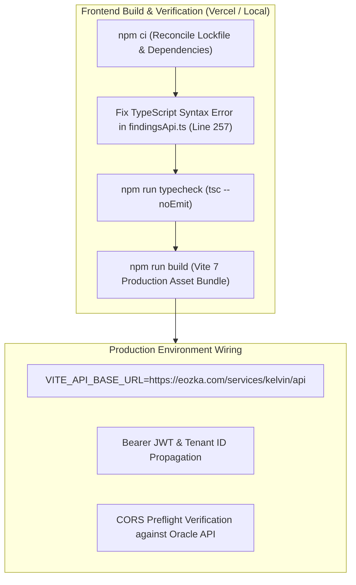

# PRE-07 — Frontend Release Readiness and API Integration

**Parent Epic:** [PRE-DEPLOY-EPIC: KELVIN Pre-Deployment Engineering Hardening](PRE-DEPLOY-EPIC_KELVIN_PRE_DEPLOYMENT_ENGINEERING_HARDENING.md) (Parent Epic #464)  
**Milestone:** [Pre-Deployment Production Hardening](../MILESTONE_PRE_DEPLOYMENT.md)  
**Issue ID:** `PRE-07`  
**Priority:** `critical` (Deployment-blocking)  
**Status:** `completed`  
**Target Pull Request:** `fix(web): resolve typescript build error and configure production api url`  

---

## 🎯 Purpose

Resolve the TypeScript compilation error in findingsApi.ts, eliminate hardcoded localhost API endpoints, validate frontend API contracts, and verify clean Vercel production build.

---

## 📐 Architecture & Workflow Diagram

---

## 📋 Detailed Requirements

- Fix the TypeScript syntax error at commit 1c876a8 in apps/web/src/features/findings/findingsApi.ts (error TS1128: Declaration or statement expected).
- Audit all API consumer calls in the frontend to ensure alignment with Go backend request/response structures.
- Remove all hardcoded localhost:8080 URLs from client code and configure environment-based base URLs (VITE_API_BASE_URL).
- Ensure authentication token storage, refresh interceptors, and 401 redirect flows operate cleanly.
- Verify that assessment creation, findings inspection, and remediation tracking render loading, empty, and error states without crashing.
- Verify CORS preflight handling and credentials transmission when deployed to Vercel.
- Execute full frontend build (npm run build) and type-check scripts to guarantee clean compilation.

---

## 🛡️ Security & Architectural Invariants

- **Mandatory Fail-Closed:** Any missing security context, tenant identifier, or cryptographic key must fail closed and refuse execution.
- **Strict Tenant Scoping:** All operations must resolve tenant context through canonical `current_tenant_id()` with RLS enforced.
- **Zero Insecure Fallbacks:** Remove all production fallback mechanisms that weaken security (e.g. `sslmode=disable`, hardcoded signing keys, nil repositories).
- **Resource Limits & Least Privilege:** Containers and database pools must be bounded to protect the 1 OCPU / 6 GB Oracle environment.

---

## ✅ Acceptance Criteria

- [x] npm run build executes cleanly with zero TypeScript errors and produces optimized bundles.
- [x] No localhost URLs or development endpoints exist in production bundles.
- [x] Frontend successfully authenticates and issues authorized API calls to the production Go backend.
- [x] Vercel deployment succeeds and serves all routes under https://eozka.com.

---

## 🔗 Related Documentation & Links

- Parent Pre-Deployment Epic: [`PRE-DEPLOY-EPIC_KELVIN_PRE_DEPLOYMENT_ENGINEERING_HARDENING.md`](PRE-DEPLOY-EPIC_KELVIN_PRE_DEPLOYMENT_ENGINEERING_HARDENING.md)
- Control Plane API: [`apps/api/`](../../../../apps/api/)
- Worker Runtime: [`apps/worker/`](../../../../apps/worker/)
- Deployment Guides: [`docs/deployment/`](../../../../docs/deployment/)
