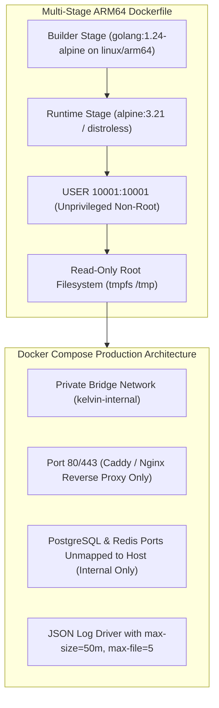

# PRE-08 — Container and Deployment Hardening

**Parent Epic:** [PRE-DEPLOY-EPIC: KELVIN Pre-Deployment Engineering Hardening](PRE-DEPLOY-EPIC_KELVIN_PRE_DEPLOYMENT_ENGINEERING_HARDENING.md) (Parent Epic #464)  
**Milestone:** [Pre-Deployment Production Hardening](../MILESTONE_PRE_DEPLOYMENT.md)  
**Issue ID:** `PRE-08`  
**Priority:** `high` (Deployment-blocking)  
**Status:** `completed`  
**Target Pull Request:** `fix(infra): harden arm64 docker images and compose network`  

---

## 🎯 Purpose

Harden Dockerfiles and Docker Compose for production Oracle Cloud Linux ARM64: multi-stage minimal builds, non-root execution, bounded writable paths, isolated internal networks, and log rotation.

---

## 📐 Architecture & Workflow Diagram

---

## 📋 Detailed Requirements

- Audit apps/api/Dockerfile and apps/worker/Dockerfile, optimizing for linux/arm64 target architecture.
- Implement multi-stage builds producing minimal runtime footprints without compilers, development tools, or package managers.
- Enforce non-root execution: create and switch to dedicated unprivileged user (UID 10001) in both API and worker containers.
- Add container HEALTHCHECK instructions probing /healthz on the API and heartbeat status on the worker.
- Ensure proper Linux signal forwarding (dumb-init / tini) to guarantee clean SIGTERM handling.
- Harden Docker Compose: isolate database and Redis inside private internal bridge networks; never expose port 5432 or 6379 to the host or internet.
- Configure log driver with rotation policies (max-size: 50m, max-file: 5) to prevent disk exhaustion on the Oracle VM.
- Verify image compilation using docker build --platform linux/arm64.

---

## 🛡️ Security & Architectural Invariants

- **Mandatory Fail-Closed:** Any missing security context, tenant identifier, or cryptographic key must fail closed and refuse execution.
- **Strict Tenant Scoping:** All operations must resolve tenant context through canonical `current_tenant_id()` with RLS enforced.
- **Zero Insecure Fallbacks:** Remove all production fallback mechanisms that weaken security (e.g. `sslmode=disable`, hardcoded signing keys, nil repositories).
- **Resource Limits & Least Privilege:** Containers and database pools must be bounded to protect the 1 OCPU / 6 GB Oracle environment.

---

## ✅ Acceptance Criteria

- [x] Docker images build successfully for linux/arm64 architecture.
- [x] Containers execute under non-root user and drop unnecessary Linux capabilities.
- [x] Database and Redis ports are unmapped from the public host network.
- [x] Container health checks pass and log rotation prevents uncontrolled disk growth.

---

## 🔗 Related Documentation & Links

- Parent Pre-Deployment Epic: [`PRE-DEPLOY-EPIC_KELVIN_PRE_DEPLOYMENT_ENGINEERING_HARDENING.md`](PRE-DEPLOY-EPIC_KELVIN_PRE_DEPLOYMENT_ENGINEERING_HARDENING.md)
- Control Plane API: [`apps/api/`](../../../../apps/api/)
- Worker Runtime: [`apps/worker/`](../../../../apps/worker/)
- Deployment Guides: [`docs/deployment/`](../../../../docs/deployment/)
