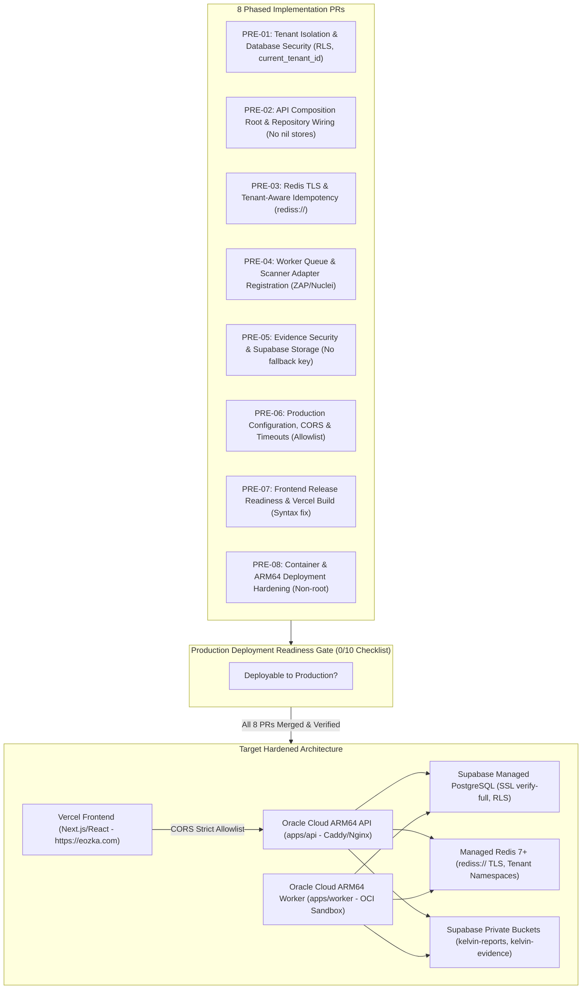

# PRE-DEPLOY-EPIC — KELVIN Pre-Deployment Engineering Hardening & Production Gate

**Project:** KELVIN — Enterprise Security Assessment Platform  
**Type:** `kind/epic` (Release-Blocking Pre-Deployment Epic)  
**Milestone:** [Pre-Deployment Production Hardening](../MILESTONE_PRE_DEPLOYMENT.md)  
**Parent Roadmap:** [ISSUE-02: Engineering Roadmap](../ISSUE-02_ENGINEERING_ROADMAP.md)  
**Priority:** `P0 — Critical` (Deployment-blocking)  
**Status:** `ready-for-dev`  
**Target Environment:** Oracle Cloud Linux ARM64 (Backend & Worker) + Vercel (Frontend) + Supabase (Database/Storage) + Redis Cloud (TLS)  

---

## 🎯 1. Objective & Current Assessment

Execute a comprehensive, release-blocking pre-deployment hardening pass across the database, backend API composition, Redis TLS, worker runtime, evidence signing, production configuration, frontend build, and container security before the first live deployment.

> [!CAUTION]
> **Current Status: Not Deployment-Ready.** Getting Docker containers to start successfully does not mean KELVIN is ready to handle real security assessments.
> The most critical deployment blockers are:
> 1. Tenant isolation inconsistencies and unauthenticated RLS bypass risks.
> 2. Incomplete API dependency wiring and uninitialized repository stores.
> 3. Missing Redis TLS configuration and unprotected idempotency keys.
> 4. Missing worker scanner adapter registrations and NopQueue placeholders.
> 5. Deterministic fallback evidence signing key and unverified storage buckets.

---

## 📐 2. Architecture & Production Hardening Topology

---

## 🗂️ 3. Phased Implementation PRs (8 Issues Total)

- [ ] **[PRE-01: Tenant Isolation and Database Security](pre-deployment/PRE-01_TENANT_ISOLATION_AND_DATABASE_SECURITY.md)** (`critical`) — Target PR: `fix(db): standardize tenant rls and job store isolation`
- [ ] **[PRE-02: API Composition and Repository Wiring](pre-deployment/PRE-02_API_COMPOSITION_AND_REPOSITORY_WIRING.md)** (`critical`) — Target PR: `fix(api): implement application composition root and repository wiring`
- [ ] **[PRE-03: Redis TLS and Idempotency Integration](pre-deployment/PRE-03_REDIS_TLS_AND_IDEMPOTENCY_INTEGRATION.md)** (`critical`) — Target PR: `fix(redis): enforce tls connection and tenant scoped idempotency`
- [ ] **[PRE-04: Worker Queue and Scanner Adapter Registration](pre-deployment/PRE-04_WORKER_QUEUE_AND_SCANNER_ADAPTER_REGISTRATION.md)** (`critical`) — Target PR: `fix(worker): register scanner adapters and wire redis queue`
- [ ] **[PRE-05: Evidence Security and Supabase Storage](pre-deployment/PRE-05_EVIDENCE_SECURITY_AND_SUPABASE_STORAGE.md)** (`critical`) — Target PR: `fix(security): remove evidence fallback key and wire supabase storage`
- [ ] **[PRE-06: Production Configuration, CORS and Observability](pre-deployment/PRE-06_PRODUCTION_CONFIGURATION_CORS_AND_OBSERVABILITY.md)** (`critical`) — Target PR: `fix(api): harden production config cors and timeouts`
- [ ] **[PRE-07: Frontend Release Readiness and API Integration](pre-deployment/PRE-07_FRONTEND_RELEASE_READINESS_AND_API_INTEGRATION.md)** (`critical`) — Target PR: `fix(web): resolve typescript build error and configure production api url`
- [ ] **[PRE-08: Container and Deployment Hardening](pre-deployment/PRE-08_CONTAINER_AND_DEPLOYMENT_HARDENING.md)** (`high`) — Target PR: `fix(infra): harden arm64 docker images and compose network`

---

## 📋 4. Detailed Requirements by Phase

- PR-01: Audit tenant migrations and database helpers. Standardize on canonical current_tenant_id(), enforce RLS across all tenant tables, and fix job-store scoping.
- PR-02: Implement application composition root in apps/api/cmd/api/main.go. Wire all repositories, job stores, findings stores, storage providers, and auth middleware. Fail fast on missing dependencies.
- PR-03: Standardize on shared Redis client with rediss:// TLS, authentication, configurable pool limits, and tenant-scoped keys.
- PR-04: Register real scanner adapters (ZAP, Nuclei, TLS) in worker registry, wire real queue, enforce OCI sandbox isolation, and verify ARM64 compatibility.
- PR-05: Remove deterministic fallback evidence signing key, require strong 32-byte production key, wire private Supabase Storage buckets, and enforce signed URLs.
- PR-06: Remove production sslmode=disable fallback, enforce strong JWT secrets, restrict CORS to deployed frontend origin, and add server timeouts and graceful drain.
- PR-07: Fix TypeScript syntax error in findingsApi.ts, validate API contracts, remove hardcoded localhost URLs, and verify clean Vercel compilation.
- PR-08: Build hardened ARM64 multi-stage Docker images running as non-root with bounded writable paths and isolated Compose networks.

---

## 🛑 5. Final Production Deployment Gate (0/10 Checklist)

Before authorizing the first live deployment to Oracle Cloud or Vercel, every item below must pass with verified proof:

- [ ] **1. Tenant Isolation:** Tenant isolation tests pass across PostgreSQL and job operations.
- [ ] **2. Dependency Composition:** All required API repositories, findings stores, and job stores are wired (no nil stores).
- [ ] **3. Redis TLS:** Redis TLS (rediss://) works cleanly from both API and worker runtimes.
- [ ] **4. Worker & Scanners:** Scanner adapters (ZAP, Nuclei, TLS) and real queue consumer are fully operational.
- [ ] **5. Private Storage:** Private Supabase Storage buckets and short-lived signed URLs work.
- [ ] **6. Cryptographic Signing:** Evidence signer has zero production fallback key; requires strong 32-byte key.
- [ ] **7. Production Config:** Production TLS (verify-full), CORS allowlist, JWT secret, and timeouts pass.
- [ ] **8. Frontend Build:** Frontend build, TypeScript checks, and integration tests pass on clean checkout.
- [ ] **9. ARM64 Containers:** ARM64 API and worker Docker images build successfully as non-root.
- [ ] **10. Database Migrations:** Database migrations execute cleanly on a disposable fresh PostgreSQL database.

---

## ✅ 6. Acceptance Criteria

- [ ] Tenant isolation tests prove Tenant A cannot read/update Tenant B records under active application roles.
- [ ] API fails fast during startup if any mandatory repository or store dependency is uninitialized.
- [ ] Redis connects securely over TLS (rediss://) with tenant-isolated namespaces and verified idempotency.
- [ ] Worker consumes assessments from real queue and executes scans inside isolated, unprivileged OCI sandboxes.
- [ ] Private evidence storage enforces cryptographic URL signing and rejects unauthenticated or cross-tenant access.
- [ ] Production environment enforces strict TLS, explicit CORS allowlist, and graceful SIGTERM draining.
- [ ] Frontend builds cleanly (npm run build) without syntax or type errors and connects to production endpoints.
- [ ] Docker ARM64 images build and pass health checks without running as root or exposing database ports.
- [ ] All 10 conditions of the final production deployment readiness checklist pass with documented proof.

---

## 🔗 7. Related Documentation & Links

- Architecture Baseline: [`docs/architecture/SYSTEM_ARCHITECTURE.md`](../../../docs/architecture/SYSTEM_ARCHITECTURE.md)
- Redis Architecture: [`docs/architecture/redis-integration.md`](../../../docs/architecture/redis-integration.md)
- Supabase Integration: [`docs/architecture/supabase-integration.md`](../../../docs/architecture/supabase-integration.md)
- Deployment Runbooks: [`docs/deployment/`](../../../docs/deployment/)
