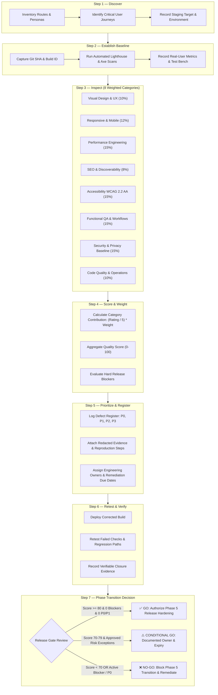
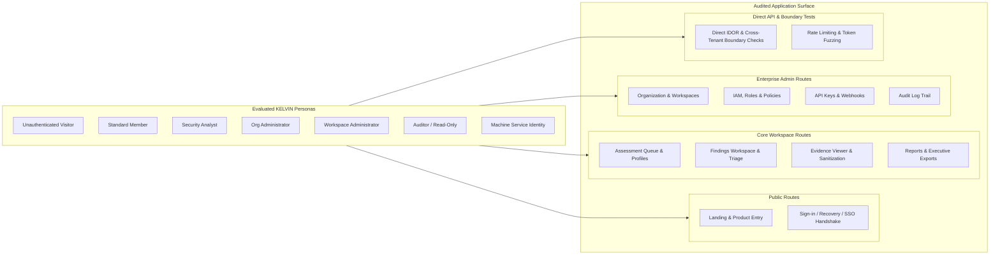
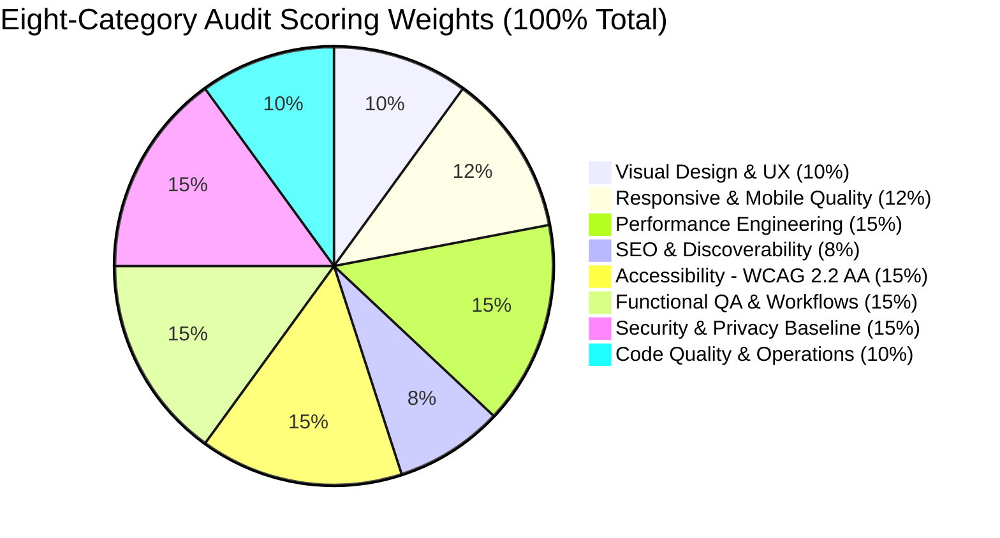
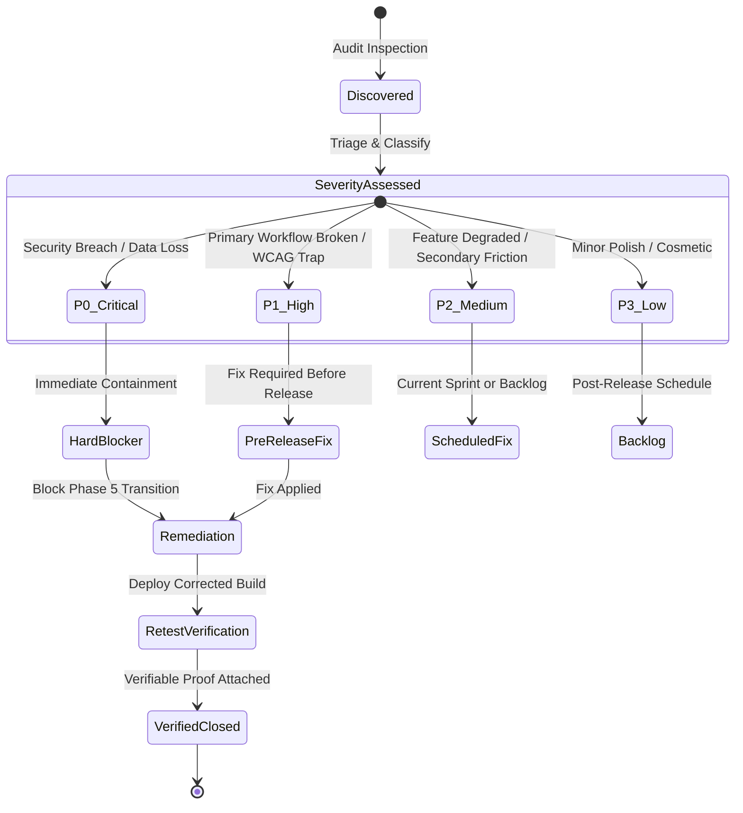

# PRE-P5-01 — Conduct the KELVIN Website Quality Assurance, UX, Accessibility & Functional Audit

**Type:** Cross-Phase Quality Gate  
**Milestone:** [Pre-Phase 5 — Final Audit & Phase Transition](../MILESTONE_PRE_PHASE_5.md)  
**Parent Roadmap:** [KELVIN — Enterprise Security Assessment Platform](../ISSUE-02_ENGINEERING_ROADMAP.md)  
**Audit Standard:** Website Quality Assurance & Design Audit Standard v1.0 — 1 November 2026  
**Reference Document:** `website_quality_audit_standard.pdf`  
**Status:** `ready-for-dev`  

---

## 🎯 1. Objective

Conduct a comprehensive, evidence-based quality assurance and design audit of the KELVIN web application before beginning **Phase 5 — Production Hardening, Deployment & Release**.

The purpose is to verify that the features and user experiences implemented across Phases 1–4 are functional, consistent, responsive, accessible, performant, secure, and maintainable.

This audit must evaluate the **actual deployed KELVIN staging build** rather than relying exclusively on source-code inspection, screenshots, design mockups, or developer assumptions.

The audit must produce:
- A complete audit record.
- Route and user-journey inventory.
- Eight-category weighted quality scorecard.
- Responsive and cross-browser test results.
- Accessibility and performance evidence.
- Functional and security baseline results.
- Prioritized defect register.
- Supporting screenshots, recordings, reports, and reproducible test cases.
- Remediation assignments and retest evidence.
- Final Go / Conditional Go / No-Go decision.

> [!IMPORTANT]
> **Core Principle:** KELVIN must not be considered production-ready merely because its features have been implemented. They must work correctly under realistic user conditions and be supported by verifiable evidence.

---

## 📐 2. Architecture & Audit Lifecycle Diagrams

### 2.1 Seven-Step Mandatory Audit Lifecycle & Phase Transition Gate



### 2.2 Persona-to-Route Authorization & Surface Coverage



### 2.3 Eight-Category Weighted Scoring Model



### 2.4 Defect Lifecycle & Hard Blocker Enforcement



---

## 🔍 3. Audit Scope

The audit covers the entire KELVIN application surface delivered through Phases 1–4.

### A. Application and Route Coverage

Inspect all applicable routes, including:
- Landing and application entry pages.
- Authentication and account recovery.
- Organization and workspace management.
- User and team administration.
- Assessment creation and scan profile selection.
- Assessment history and execution status.
- Findings workspace and finding details.
- Evidence retrieval and management.
- Remediation tracking and verification.
- Assessment reports and exports.
- Enterprise settings and policy management.
- SSO and access management.
- API credential and integration management.
- Administrative and audit interfaces.
- Error, unauthorized, forbidden, and not-found routes.

Create a route inventory containing:
- Route URL path.
- User role required.
- Purpose.
- Authentication requirement.
- Expected result.
- Audit status.
- Related defects.

*Do not assume every route is available to every user.*

### B. User Roles and Permissions

Perform tests using the supported KELVIN personas and authorization levels:
- Unauthenticated visitor.
- Standard organization member.
- Security analyst.
- Organization administrator.
- Workspace administrator.
- Auditor or read-only user.
- Service identity, where applicable.

Verify that interface visibility, server-side permissions, and actual resource access remain consistent.  
**Unauthorized access must be tested through direct API requests and manipulated resource identifiers, not just by checking whether buttons are hidden.**

### C. Main User Journeys

Document and test critical end-to-end journeys:
1. User signs in and enters the correct organization workspace.
2. User creates an authorized assessment.
3. Assessment is queued and its execution status is displayed.
4. User opens completed assessment results.
5. User searches and filters findings.
6. User opens a finding and reviews its evidence.
7. User updates finding or remediation status with permitted access.
8. User initiates follow-up verification.
9. User generates and downloads an assessment report.
10. Organization administrator manages users, roles, and policies.
11. Auditor reviews relevant activity and audit records.
12. Integration or service identity performs its permitted operation.

*Record any journey that is not implemented or cannot be tested as an explicit exclusion or defect.*

---

## 📊 4. Eight-Category Audit Framework

Use the weighted scoring model from the supplied audit standard:

| Category | Weight | Audit Coverage |
| :--- | :---: | :--- |
| **Visual Design & UX** | 10% | Consistency, hierarchy, readability, components and design patterns |
| **Responsive & Mobile** | 12% | Viewports, overflow, navigation, touch targets and reflow |
| **Performance** | 15% | Core Web Vitals, Lighthouse, assets and responsiveness |
| **SEO & Discoverability** | 8% | Metadata, indexing, canonical URLs and social sharing |
| **Accessibility** | 15% | WCAG 2.2 AA, keyboard, screen readers, contrast and focus |
| **Functional QA** | 15% | Routes, forms, states, workflows, navigation and error handling |
| **Security & Privacy** | 15% | Authentication, authorization, secrets, headers and data handling |
| **Code Quality & Operations** | 10% | Tests, runtime errors, maintainability, configuration and monitoring |
| **Total** | **100%** | |

---

### Category 1 — Visual Design & UX (Weight: 10%)

**Inspect:**
- Consistent colors and semantic design tokens.
- Typography and heading hierarchy.
- Spacing and alignment.
- Component consistency across all modules.
- Button and input behavior.
- Navigation clarity.
- Dashboard information hierarchy.
- Data-table readability.
- Empty, loading, error and success-state design.
- Icons, imagery, animation, shadows and visual effects.
- Consistency between desktop and mobile layouts.

Evaluate visual patterns according to their actual usability impact. Do not automatically classify gradients, shadows, rounded corners, bento grids, dark themes, Lucide icons, animations, or other popular design patterns as defects. Flag them only when they negatively affect clarity, accessibility, consistency, performance, or trust.

**Acceptance Criteria:**
- [ ] Each page has a clear purpose.
- [ ] Primary actions are identifiable.
- [ ] Repeated components behave consistently.
- [ ] No broken, misleading, or placeholder visual elements remain.
- [ ] Animations respect reduced-motion preferences.
- [ ] No important interaction depends exclusively on hover.

---

### Category 2 — Responsive & Mobile Quality (Weight: 12%)

Test the following reference viewport matrix:

| Device Class | Viewport Dimensions |
| :--- | :--- |
| **Small phone** | 320 × 568 px |
| **Common phone** | 360–390 px wide |
| **Large phone** | 414–430 px wide |
| **Tablet portrait** | 768 px wide |
| **Tablet / small laptop** | 1024 px wide |
| **Desktop** | 1366 px wide |
| **Large desktop** | 1440–1920 px wide |

**Inspect:**
- Unintended horizontal document scrolling.
- Clipped and overlapping content.
- Mobile navigation.
- Responsive tables and data visualizations.
- Dialog and modal dimensions.
- Form usability.
- Touch interactions.
- Sticky headers and floating elements.
- 200% zoom and 320 CSS-pixel reflow.

**Acceptance Criteria:**
- [ ] No unintended page-level horizontal overflow.
- [ ] No critical controls are clipped or hidden.
- [ ] Menus and dialogs remain usable.
- [ ] Primary touch targets aim for 44 × 44 CSS pixels.
- [ ] Applicable WCAG target-size requirements are respected.
- [ ] Essential information remains available at narrow widths and increased zoom.

---

### Category 3 — Performance Engineering (Weight: 15%)

Measure performance on representative public and authenticated routes.

| Metric | Target Standard |
| :--- | :---: |
| **Largest Contentful Paint (LCP)** | ≤ 2.5 seconds |
| **Interaction to Next Paint (INP)** | ≤ 200 ms |
| **Cumulative Layout Shift (CLS)** | ≤ 0.1 |
| **Lighthouse Performance Score** | Aim for ≥ 90 |

*Use the 75th percentile for field Core Web Vitals where sufficient real-user data exists.*

**Inspect:**
- Initial JavaScript and route bundles.
- Image formats, dimensions and loading.
- Font loading.
- Unnecessary third-party scripts.
- Render-blocking resources.
- API latency.
- Large dashboard queries.
- Search and filtering responsiveness.
- Report rendering.
- Evidence retrieval.
- Caching and compression.
- Mobile CPU and network behavior.

*Do not apply an arbitrary small marketing-page bundle budget to complex authenticated dashboards. Define appropriate route-specific budgets.*

**Acceptance Criteria:**
- [ ] Lighthouse reports are captured for representative routes.
- [ ] Core Web Vitals are measured where field data is available.
- [ ] Major performance bottlenecks are documented.
- [ ] Authenticated data is never publicly cached.
- [ ] Performance is tested under constrained network/CPU conditions.

---

### Category 4 — SEO & Discoverability (Weight: 8%)

Apply SEO requirements to public, intended-to-be-indexed KELVIN pages.

**Inspect:**
- Page titles and meta descriptions.
- Favicon and Web App Manifest.
- Canonical URLs and robots directives (`robots.txt`, `sitemap.xml`).
- Semantic HTML structure and heading levels (`H1`–`H6`).
- Meaningful image alternative text (`alt`).
- Open Graph metadata (`og:title`, `og:image`, `og:description`).
- Structured data where genuinely applicable.
- Broken links and redirects.

> [!CAUTION]
> **Data Privacy:** Authenticated routes, assessment results, findings, organization records, private reports, and administrative content must not be exposed through public indexing. Do not rely on `robots.txt` as an access-control mechanism.

**Acceptance Criteria:**
- [ ] Public indexable routes have correct metadata.
- [ ] Private application routes remain protected by authentication and authorization.
- [ ] No staging or private routes are inadvertently indexed.
- [ ] Redirects and canonical URLs are correct.
- [ ] No fabricated ratings, claims, or structured data are present.

---

### Category 5 — Accessibility (Weight: 15%)

Use **WCAG 2.2 Level AA** as the default audit target. Perform automated and manual checks.

**Required Checks:**
- Normal text contrast: ≥ 4.5:1.
- Large text contrast: ≥ 3:1.
- Applicable non-text UI contrast: ≥ 3:1.
- Keyboard operation without traps.
- Logical focus sequence.
- Visible and unobscured focus rings.
- Accessible names for interactive controls.
- Useful validation and error announcements.
- Screen-reader review of critical journeys (NVDA, VoiceOver, TalkBack).
- 200% zoom and narrow-viewport testing (320px reflow).

*Recommended tools: axe-core, Lighthouse accessibility, WAVE, NVDA, VoiceOver. Automated scans must not be treated as proof of WCAG conformance.*

**Acceptance Criteria:**
- [ ] Complete keyboard navigability across all views.
- [ ] WCAG 2.2 Level AA color contrast targets met.
- [ ] Screen reader compatibility verified on critical journeys.
- [ ] Dialogs trap focus properly and release on close.
- [ ] ARIA attributes conform strictly to WAI-ARIA standards.

---

### Category 6 — Functional Quality Assurance (Weight: 15%)

Test all visible interactive elements and core workflows.

**Inspect:**
- Navigation, headers, footers and breadcrumbs.
- Authentication, SSO handshakes, and token refresh.
- User and organization management.
- Assessment submission and duplicate submission prevention.
- Assessment cancellation.
- Background execution status polling/streaming.
- Finding retrieval, filtering, and state transitions.
- Evidence access and sanitization verification.
- Report creation and PDF/HTML downloads.
- Remediation tracking and re-verification triggers.
- Integration configuration (Jira, Slack, webhooks).
- API credential issuance and revocation.
- Forms and validation behavior.
- Search and pagination.
- Empty, loading, error and success states.
- Unauthorized (401) and forbidden (403) handling.
- Not Found (404) behavior.
- Session expiration and logout.
- Retry, timeout and recovery behavior.

**Acceptance Criteria:**
- [ ] Every visible control performs its documented action.
- [ ] Forms handle empty, invalid, duplicate and successful submissions correctly.
- [ ] Errors are understandable and do not reveal internal stack traces.
- [ ] Empty, loading, error and success states are implemented.
- [ ] Deleted and missing resources return appropriate error behavior.
- [ ] Critical user journeys pass end to end.
- [ ] No primary workflow depends on placeholder data or non-functional actions.

---

### Category 7 — Security & Privacy Baseline (Weight: 15%)

Perform an application security and privacy baseline audit.

**Inspect:**
- HTTPS and TLS configuration.
- Secrets and credential exposure in client builds.
- Authentication and session handling.
- Server-side authorization (RBAC/ABAC).
- Tenant and organization isolation (ADR-0002).
- Input validation and output encoding (XSS prevention).
- Insecure Direct Object References (IDOR) and privilege escalation.
- API rate limiting and brute-force defenses.
- Security headers (`Content-Security-Policy`, `HSTS`, `X-Content-Type-Options`, `X-Frame-Options`).
- CORS configuration.
- File uploads and object access controls.
- Evidence and report authorization.
- Logging and sensitive-data exposure.
- Third-party dependency vulnerabilities (`npm audit`, `govulncheck`).
- Backup and restoration expectations.
- Privacy disclosures and terms.

> [!WARNING]
> Verify that private keys, service credentials, database passwords, and privileged API keys do not appear in browser-delivered code, public source code, or build artifacts.

**Acceptance Criteria:**
- [ ] No unauthorized user can read or modify another organization's private resources.
- [ ] Server-side permissions protect sensitive operations.
- [ ] Secrets are not exposed through frontend code or logs.
- [ ] Production-like error responses do not reveal stack traces.
- [ ] Sensitive information is redacted where required (ADR-0005).
- [ ] Privacy and terms disclosures reflect actual product behavior.

*Note: This baseline review does not replace the independent penetration testing required in Phase 5.*

---

### Category 8 — Code Quality & Production Operations (Weight: 10%)

**Inspect:**
- Browser console and runtime errors.
- Go backend errors and unhandled exceptions.
- TypeScript type safety (`tsc --noEmit`).
- Linting and formatting (`golangci-lint`, `eslint`, `prettier`).
- Unit, integration and end-to-end tests.
- API contract consistency (OpenAPI / JSON schemas).
- Configuration and environment variables.
- Database migration rollback procedures.
- Build reproducibility.
- Deployment and rollback documentation.
- Monitoring and error reporting (Sentry, OpenTelemetry).
- Analytics and privacy considerations.
- README and technical onboarding documentation.

**Acceptance Criteria:**
- [ ] Production builds succeed cleanly (`go build`, `npm run build`).
- [ ] No unresolved critical runtime errors remain on primary journeys.
- [ ] Type checks and required linting pass without errors.
- [ ] Critical application paths have repeatable automated tests.
- [ ] Environment configuration is documented without exposing secrets.
- [ ] Monitoring, backup and rollback expectations are documented.
- [ ] A new developer can understand and run the project using the documentation.

---

## 📈 5. Scoring Model & Release Decision Matrix

Every audit category must receive an individual rating from **0 to 5**:

| Rating | Meaning | Definition |
| :---: | :--- | :--- |
| **0** | Absent | Requirement missing or fundamentally unusable |
| **1** | Critical | Severe defects compromising the experience or security |
| **2** | Weak | Partially implemented with major defects |
| **3** | Acceptable | Works for typical cases with some gaps |
| **4** | Strong | Consistent and verified with minor defects |
| **5** | Excellent | Measured, accessible, resilient and continuously maintained |

$$	ext{Category Contribution} = \left(rac{	ext{Category Rating}}{5}
ight) 	imes 	ext{Category Weight}$$

$$	ext{Overall Score} = \sum 	ext{Category Contributions} \quad (	ext{Maximum} = 100)$$

### Release Score Bands

| Score | Result | Decision |
| :---: | :--- | :--- |
| **90–100** | **Excellent** | Release-ready if all hard gates pass |
| **80–89** | **Good** | Release-ready; track medium and low defects |
| **70–79** | **Conditional** | Requires documented ownership, mitigation, and approval |
| **< 70** | **Not Ready** | Remediation and re-audit mandatory |

*A high numerical score cannot override a hard release blocker.*

---

## 🚨 6. Defect Severity & Hard Release Blockers

### Defect Severity Classification

| Severity | Definition | Required Response |
| :--- | :--- | :--- |
| **P0 — Critical** | Security/privacy breach, data loss, unsafe transaction or site unavailable | Stop release and immediately contain |
| **P1 — High** | Primary journey broken, widespread mobile failure or serious accessibility barrier | Fix before release |
| **P2 — Medium** | Important functionality degraded or substantial secondary friction | Fix in current release or approved remediation plan |
| **P3 — Low** | Minor visual inconsistency, copy issue or low-impact polish defect | Schedule in backlog |

### Hard Release Blockers

Regardless of the aggregate score, the following **strictly block release to Phase 5**:
- ❌ Exploitable critical or high security issues.
- ❌ Exposed credentials, secret keys, or private certificates.
- ❌ Unauthorized access to customer, organization, or personal data.
- ❌ Broken primary assessment, authentication, or critical customer workflow.
- ❌ Major keyboard traps or inaccessible core user group workflows.
- ❌ Site-wide broken navigation.
- ❌ Severe mobile failure affecting primary workflows.

*No P0 issue may remain unresolved for a release decision. P1 issues must be fixed before release unless a formal, explicitly justified risk decision is approved under the applicable governance process.*

---

## 📑 7. Audit Report Deliverables Structure

Produce the following artifacts in the KELVIN documentation repository:

```text
docs/
└── quality-audit/
    ├── README.md
    ├── AUDIT_SCOPE.md
    ├── ROUTE_INVENTORY.md
    ├── USER_JOURNEY_MATRIX.md
    ├── AUDIT_CHECKLIST.md
    ├── SCORECARD.md
    ├── DEFECT_REGISTER.md
    ├── SECURITY_BASELINE.md
    ├── ACCESSIBILITY_REPORT.md
    ├── PERFORMANCE_REPORT.md
    ├── FUNCTIONAL_QA_REPORT.md
    ├── RESPONSIVE_AUDIT_REPORT.md
    ├── REMEDIATION_TRACKER.md
    ├── RELEASE_DECISION.md
    └── evidence/
        ├── screenshots/
        ├── recordings/
        ├── lighthouse/
        ├── accessibility/
        ├── security/
        └── test-results/
```

### Audit Record Metadata

| Field | Value |
| :--- | :--- |
| **Project** | KELVIN Security Assessment Platform |
| **Environment** | Staging |
| **Release / Commit** | Actual tested build commit SHA |
| **Audit Date** | Execution timestamp |
| **Audit Owner** | Assigned Lead Reviewer |
| **Scope** | All application routes and 12 user journeys |
| **Devices / Browsers** | 7 viewports × Chrome, Firefox, Safari, Edge |
| **Test Accounts / Roles** | Non-production accounts across 7 personas |
| **Overall Score** | Calculated weighted score (0–100) |
| **Release Status** | `Go` / `Conditional Go` / `No-Go` |
| **Critical Blockers** | AUD finding references (or None) |
| **Limitations** | Documented test exclusions |

### Defect Register Schema

Use identifiers such as `AUD-001`, `AUD-002`, `AUD-003`:
- **Title:** Short, specific defect name.
- **Environment:** URL, build SHA, browser, viewport and user persona.
- **Severity:** P0 / P1 / P2 / P3.
- **Steps to Reproduce:** Deterministic, numbered reproduction steps.
- **Expected:** Expected behavior according to specifications.
- **Actual:** Actual observed behavior.
- **Impact:** Affected users, data security, and business impact.
- **Evidence:** Redacted screenshot, video recording, network trace, metric or request ID.
- **Recommendation:** Technical remediation direction.
- **Owner:** Responsible engineering owner.
- **Due Date:** Agreed remediation target date.
- **Status:** Open / In Progress / Fixed / Retest Required / Verified / Accepted Risk.
- **Retest Evidence:** Corrected build SHA and verification proof.

---

## ✍️ 8. Sign-Off Requirements

The final audit requires explicit sign-off from four distinct disciplines:

| Role | Sign-Off Responsibility | Sign-Off Status |
| :--- | :--- | :---: |
| **Lead Developer** | Technical corrections, type safety, and code quality | `[ ] Pending` |
| **QA Reviewer** | Test execution, reproducibility and defect verification | `[ ] Pending` |
| **Design / Product Reviewer** | UX, visual consistency, mobile layout and product behavior | `[ ] Pending` |
| **Technical / Security Owner** | Architecture, authorization, tenant isolation and security review | `[ ] Pending` |

*Every approval must include the responsible person's identity, decision, notes, and timestamp. "Looks fine" is not an auditable approval.*

---

## ✅ 9. Definition of Done

This issue may be closed only when:
- [ ] Audit scope and staging build SHA are identified.
- [ ] All applicable KELVIN routes are inventoried.
- [ ] All supported user roles and 12 primary journeys are covered.
- [ ] All eight audit categories are evaluated and scored.
- [ ] Required desktop, tablet and mobile viewports are tested.
- [ ] Functional workflows and error states are verified.
- [ ] Accessibility testing includes automated and manual assistive technology checks.
- [ ] Performance measurements and Lighthouse reports are captured.
- [ ] SEO checks are completed for applicable public pages.
- [ ] Security and privacy baseline checks are completed.
- [ ] Weighted quality score is calculated.
- [ ] P0/P1/P2/P3 defect register is completed.
- [ ] Hard release blockers are explicitly identified and cleared.
- [ ] Evidence is attached and sensitive data is redacted.
- [ ] Remediation owners and due dates are assigned.
- [ ] Fixed defects have verified retest evidence.
- [ ] Final audit report and release decision are documented.
- [ ] Developer, QA, Product/Design and Technical/Security sign-offs are recorded.

---

## 🚪 10. Phase Transition Rule

This issue acts as the **formal quality gate** between Phase 4 and Phase 5.

**The team must not begin Phase 5 until:**
1. The complete audit has been performed.
2. All critical (P0) findings have been resolved.
3. High-severity (P1) findings have been resolved or explicitly handled through an approved risk exception.
4. The weighted score and release status are documented.
5. The audit report and supporting evidence are published in `docs/quality-audit/`.
6. All four responsible reviewers have signed off on the audit outcome.

> [!NOTE]
> **Boundary Notice:** This audit establishes the baseline quality, usability, and functional readiness of the platform. It does not replace the independent penetration testing, production infrastructure provisioning, disaster recovery validation, and operational runbooks scheduled in Phase 5.
