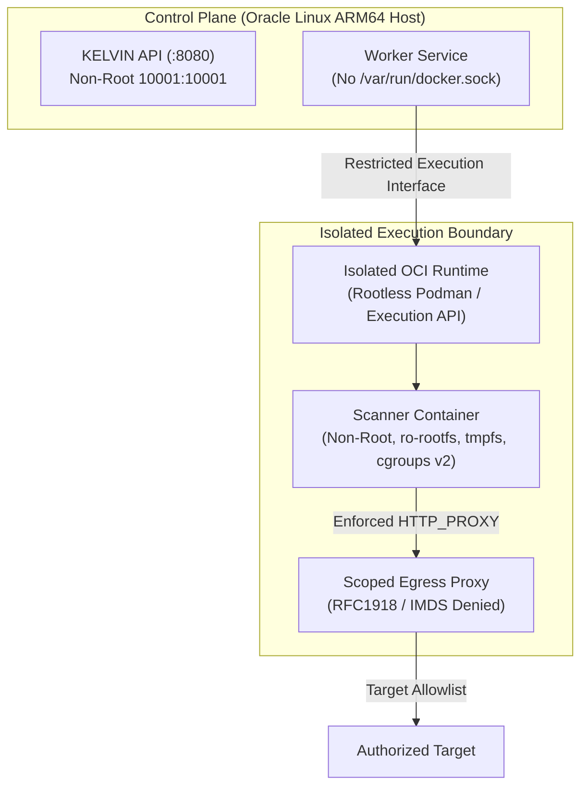

# EXEC-001 — Define the Secure OCI Execution Architecture

**Milestone:** Scanner Execution Platform (Milestone #10)  
**Phase:** Phase 0 — Architecture and Repository Audit  
**Issue ID:** `EXEC-001`  
**Priority:** `critical`  
**Status:** `ready-for-dev`  

---

## 🎯 Purpose

Resolve the containerized worker and OCI runtime mismatch without exposing an unrestricted host Docker socket.

---

## 📐 Architecture & Workflow Diagram

---

## 📋 Detailed Requirements

- Evaluate worker process running as dedicated unprivileged host user with rootless Podman vs dedicated scanner execution service with authenticated API.
- Strictly prohibit mounting /var/run/docker.sock into worker containers.
- Ensure runtime compatibility with ARM64 and cgroups v2 on Oracle Linux 9.8.
- Define network isolation preventing scanner containers from accessing the host or internet directly.
- Define memory, CPU, PID, and execution-time limits with guaranteed cleanup.
- Create Architecture Decision Record (ADR-0008) documenting chosen design and threat model.

---

## ✅ Acceptance Criteria

- [ ] No unrestricted Docker socket is exposed to the worker.
- [ ] Runtime access is restricted to the dedicated execution identity.
- [ ] Scanner containers execute as non-root (UID 10001:10001).
- [ ] Runtime works on ARM64 and cgroups v2.
- [ ] The selected design supports network isolation and resource limits.
- [ ] Runtime failure is surfaced as an explicit readiness failure.
