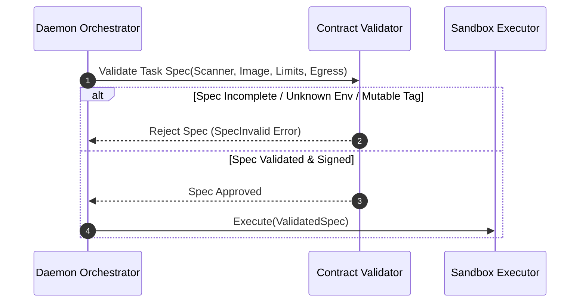

# EXEC-002 — Define Scanner Execution and Security Contracts

**Milestone:** Scanner Execution Platform (Milestone #10)  
**Phase:** Phase 0 — Architecture and Repository Audit  
**Issue ID:** `EXEC-002`  
**Priority:** `critical`  
**Status:** `ready-for-dev`  

---

## 🎯 Purpose

Formalize the contract between daemon, sandbox executor, egress proxy, and scanner adapters.

---

## 📐 Architecture & Workflow Diagram

---

## 📋 Detailed Requirements

- Define strict schema for scanner identity, immutable image digest, version, and template catalog.
- Enforce strict executable and argument allowlist without shell invocation.
- Enforce environment variable allowlists, rejecting undeclared variables.
- Require valid egress proxy policy whenever NetworkDisabled is false.
- Add validation unit tests for malformed or incomplete execution specifications.

---

## ✅ Acceptance Criteria

- [ ] All scanner executions pass through one validated execution contract.
- [ ] Unknown scanner identities are rejected.
- [ ] Unknown environment variables are rejected.
- [ ] Image references must be immutable and approved.
- [ ] Network-enabled execution requires an enforced egress policy.
- [ ] Tests cover malformed and incomplete specifications.
