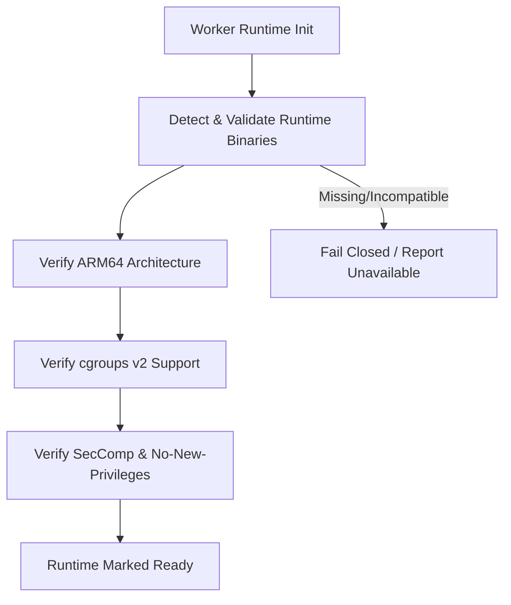

# EXEC-004 — Implement the Approved ARM64 OCI Runtime

**Milestone:** Scanner Execution Platform (Milestone #10)  
**Phase:** Phase 1 — Worker and OCI Runtime  
**Issue ID:** `EXEC-004`  
**Priority:** `critical`  
**Status:** `ready-for-dev`  

---

## 🎯 Purpose

Implement the runtime selected in Issue 001 for Oracle Linux 9.8 ARM64 with cgroups v2.

---

## 📐 Architecture & Workflow Diagram

---

## 📋 Detailed Requirements

- Detect and validate runtime binary on ARM64 host environment.
- Verify cgroups v2 availability and resource enforcement capabilities.
- Enforce non-root execution, read-only rootfs, and dropped capabilities.
- Prevent arbitrary host mounts and unauthorized images.

---

## ✅ Acceptance Criteria

- [ ] Runtime initialization succeeds on Oracle ARM64.
- [ ] Runtime verification fails closed if runtime is absent or misconfigured.
- [ ] An unapproved image cannot execute.
- [ ] Resource limits are verified against actual runtime configuration.
- [ ] A container cannot access the host filesystem or runtime socket.
- [ ] Runtime integration tests pass.
