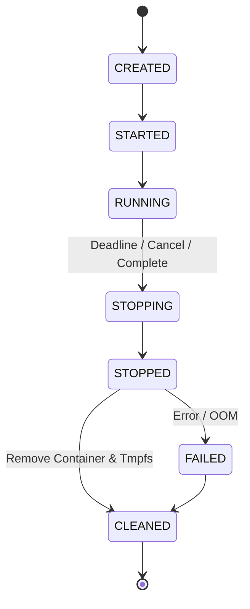

# EXEC-005 — Implement Scanner Container Lifecycle Management

**Milestone:** Scanner Execution Platform (Milestone #10)  
**Phase:** Phase 1 — Worker and OCI Runtime  
**Issue ID:** `EXEC-005`  
**Priority:** `critical`  
**Status:** `ready-for-dev`  

---

## 🎯 Purpose

Harden container creation, execution, bounded output capture, and cleanup.

---

## 📐 Architecture & Workflow Diagram

---

## 📋 Detailed Requirements

- Enforce explicit lifecycle states: CREATED, STARTED, RUNNING, STOPPING, STOPPED, FAILED, CLEANED.
- Use cryptographically random container names and execution labels.
- Enforce bounded stdout/stderr capture (DefaultMaxCaptureBytes).
- Implement forced SIGKILL after graceful timeout grace period and ensure complete removal.

---

## ✅ Acceptance Criteria

- [ ] No scanner container remains after completed execution.
- [ ] Cancellation stops the actual scanner process.
- [ ] A timeout cannot leave an orphaned container.
- [ ] Output limits are enforced.
- [ ] Concurrent executions do not collide.
- [ ] Cleanup works after daemon interruption.
