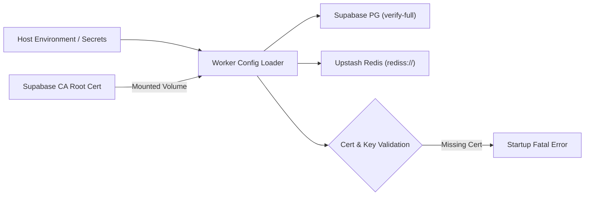

# EXEC-006 — Implement Worker Configuration and Certificate Handling

**Milestone:** Scanner Execution Platform (Milestone #10)  
**Phase:** Phase 1 — Worker and OCI Runtime  
**Issue ID:** `EXEC-006`  
**Priority:** `critical`  
**Status:** `ready-for-dev`  

---

## 🎯 Purpose

Ensure the worker receives correct configuration and trusted Supabase/Redis CA certificates.

---

## 📐 Architecture & Workflow Diagram

---

## 📋 Detailed Requirements

- Mount and validate Supabase root CA certificate into the worker container.
- Validate Upstash Redis TLS configuration on startup.
- Ensure secrets never leak into logs or command line invocations.
- Execute worker under dedicated unprivileged identity (10001:10001).

---

## ✅ Acceptance Criteria

- [ ] Worker can verify Supabase PostgreSQL certificates with verify-full.
- [ ] Worker can connect to Upstash using TLS.
- [ ] Missing CA certificates cause an explicit startup failure.
- [ ] Secrets never appear in logs.
- [ ] Worker runs under a dedicated unprivileged identity.
