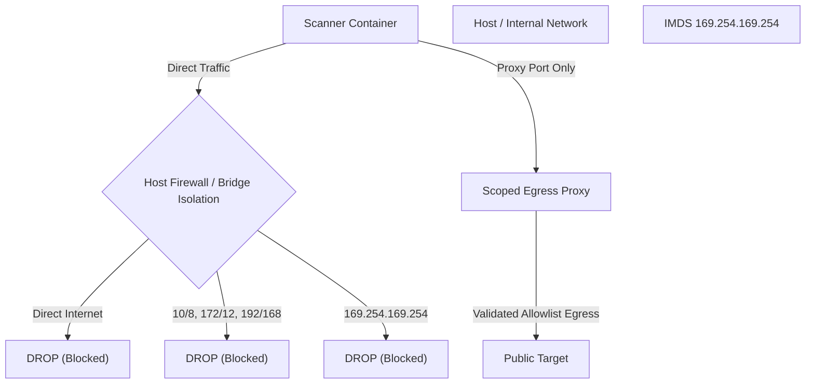

# EXEC-007 — Implement Scanner-Only Internal Network Isolation

**Milestone:** Scanner Execution Platform (Milestone #10)  
**Phase:** Phase 2 — Network Isolation and Egress  
**Issue ID:** `EXEC-007`  
**Priority:** `critical`  
**Status:** `ready-for-dev`  

---

## 🎯 Purpose

Prevent scanner containers from directly accessing the internet or internal infrastructure.

---

## 📐 Architecture & Workflow Diagram

---

## 📋 Detailed Requirements

- Isolate scanner network namespace: direct outbound connections must be rejected.
- Block access to RFC1918 private ranges and cloud metadata endpoints (169.254.169.254).
- Permit communication only to the designated egress proxy endpoint.
- Separate control plane network from scanner execution network.

---

## ✅ Acceptance Criteria

- [ ] Direct outbound HTTP and HTTPS from a scanner container fails.
- [ ] Access to private IP ranges and cloud metadata endpoints fails.
- [ ] Access to the approved proxy succeeds.
- [ ] The proxy can reach an authorized public target and blocks unauthorized targets.
- [ ] Network isolation tests run automatically in CI or staging.
