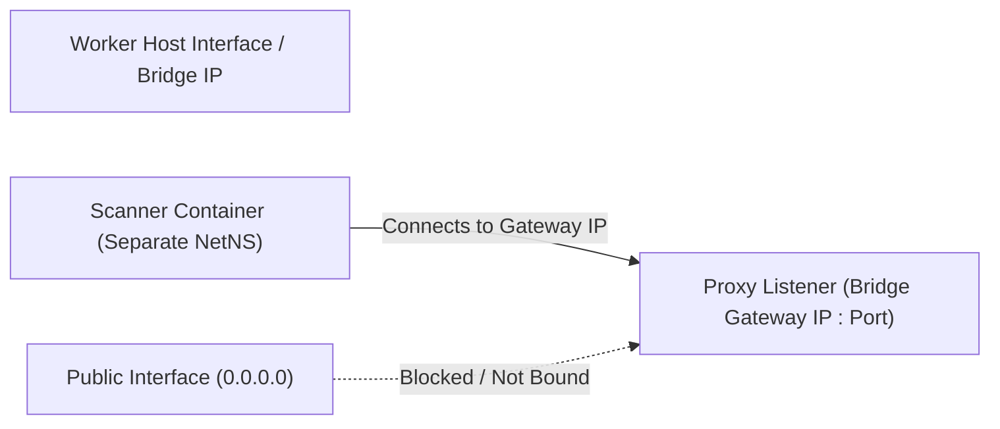

# EXEC-008 — Fix Egress Proxy Endpoint Accessibility

**Milestone:** Scanner Execution Platform (Milestone #10)  
**Phase:** Phase 2 — Network Isolation and Egress  
**Issue ID:** `EXEC-008`  
**Priority:** `critical`  
**Status:** `ready-for-dev`  

---

## 🎯 Purpose

Fix loopback-only proxy binding so scanner containers can reach the egress proxy without exposing it publicly.

---

## 📐 Architecture & Workflow Diagram

---

## 📋 Detailed Requirements

- Replace 127.0.0.1:0 binding with a runtime-aware endpoint provider (internal bridge gateway IP).
- Do not expose proxy on public or control-plane interfaces.
- Associate proxy instances strictly with single execution contexts and ensure shutdown on completion.

---

## ✅ Acceptance Criteria

- [ ] Scanner can connect to the intended proxy endpoint.
- [ ] Proxy cannot be reached from the public internet.
- [ ] Proxy instances cannot be reused across unrelated tenants.
- [ ] Proxy is stopped after execution.
- [ ] Tests no longer assume that scanner and worker share localhost.
