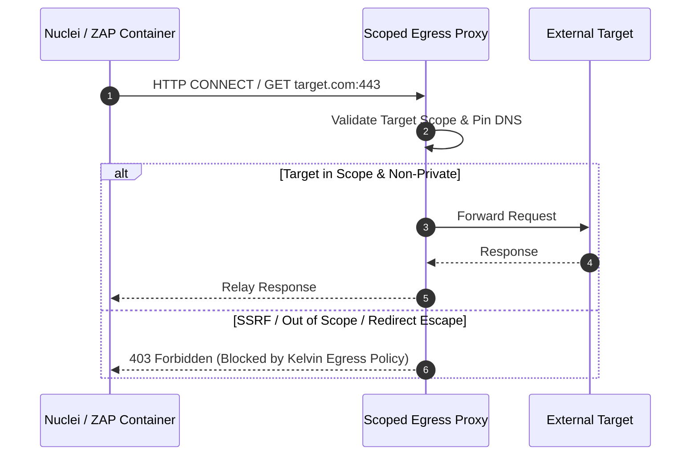

# EXEC-009 — Enforce Proxy-Only Egress for Nuclei and ZAP

**Milestone:** Scanner Execution Platform (Milestone #10)  
**Phase:** Phase 2 — Network Isolation and Egress  
**Issue ID:** `EXEC-009`  
**Priority:** `critical`  
**Status:** `ready-for-dev`  

---

## 🎯 Purpose

Enforce egress proxy policy consistently across all network-enabled scanners.

---

## 📐 Architecture & Workflow Diagram

---

## 📋 Detailed Requirements

- Require a valid egress policy for Nuclei and ZAP, rejecting NetworkDisabled=false without proxy.
- Enforce destination port allowlists and prevent scope escapes via HTTP redirects.
- Implement DNS pinning and anti-DNS rebinding defenses.

---

## ✅ Acceptance Criteria

- [ ] Nuclei cannot run with unrestricted networking.
- [ ] ZAP cannot run with unrestricted networking.
- [ ] Invalid proxy configuration fails before container creation.
- [ ] Redirects outside the approved scope are blocked.
- [ ] IPv4 and IPv6 private destinations are blocked.
- [ ] DNS rebinding tests pass.
