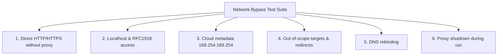

# EXEC-010 — Add Network Bypass and Isolation Regression Tests

**Milestone:** Scanner Execution Platform (Milestone #10)  
**Phase:** Phase 2 — Network Isolation and Egress  
**Issue ID:** `EXEC-010`  
**Priority:** `critical`  
**Status:** `ready-for-dev`  

---

## 🎯 Purpose

Create comprehensive integration test suite proving scanner containers cannot bypass the egress proxy.

---

## 📐 Architecture & Workflow Diagram

---

## 📋 Detailed Requirements

- Implement integration tests using real container network namespaces.
- Verify direct egress is dropped while authorized proxy requests succeed.
- Verify denial of cloud metadata, private IP ranges, and unauthorized hosts.

---

## ✅ Acceptance Criteria

- [ ] All bypass tests fail safely.
- [ ] All authorized proxy tests pass.
- [ ] Network tests use real container namespaces, not only mocked HTTP clients.
- [ ] Security regression tests run before scanner release.
