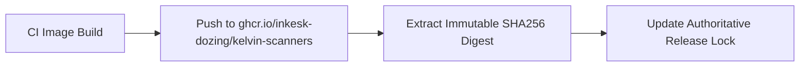

# EXEC-012 — Publish Scanner Images to GHCR

**Milestone:** Scanner Execution Platform (Milestone #10)  
**Phase:** Phase 3 — Scanner Image Release and Certification  
**Issue ID:** `EXEC-012`  
**Priority:** `critical`  
**Status:** `ready-for-dev`  

---

## 🎯 Purpose

Publish multi-arch/ARM64 scanner images to GitHub Container Registry with immutable digests.

---

## 📐 Architecture & Workflow Diagram

---

## 📋 Detailed Requirements

- Authenticate build pipeline to GHCR with minimal required token scopes.
- Push ARM64 images and publish immutable image digests.
- Prevent usage of mutable latest tags in staging and production.

---

## ✅ Acceptance Criteria

- [ ] GHCR contains the approved Nuclei image.
- [ ] GHCR contains the approved ZAP image.
- [ ] Images are pullable from Oracle VM.
- [ ] Release metadata contains immutable digests.
- [ ] Oracle can verify the digest before execution.
