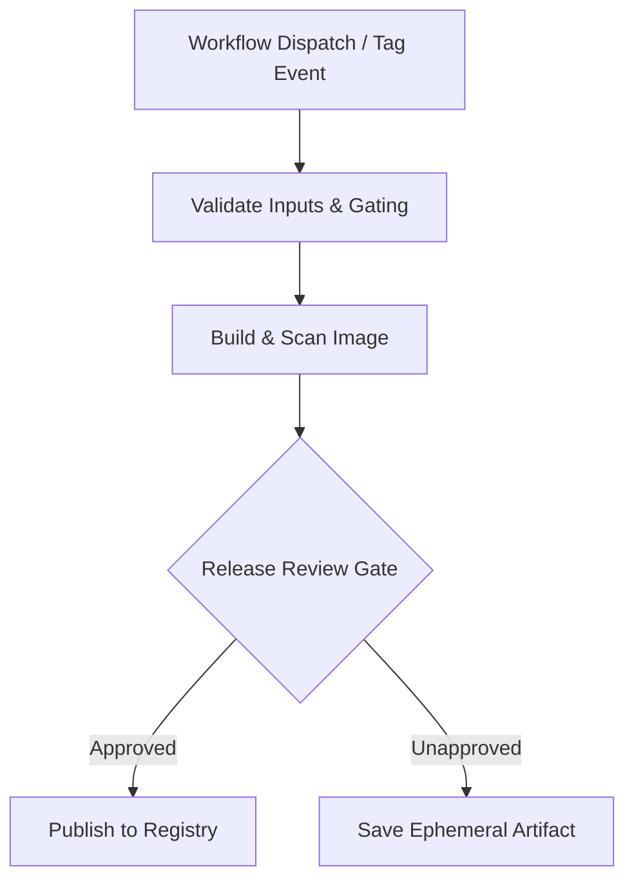

# EXEC-013 — Repair Scanner Image Workflow Gating

**Milestone:** Scanner Execution Platform (Milestone #10)  
**Phase:** Phase 3 — Scanner Image Release and Certification  
**Issue ID:** `EXEC-013`  
**Priority:** `critical`  
**Status:** `completed`  

---

## 🎯 Purpose

Fix GitHub Actions scanner-images.yml workflow gating syntax and permissions.

---

## 📐 Architecture & Workflow Diagram

---

## 📋 Detailed Requirements

- Replace invalid env.ENABLE_CI job condition with supported vars/inputs condition.
- Prevent unreviewed runs from publishing certified images.
- Enforce least-privilege workflow permissions.

---

## ✅ Acceptance Criteria

- [x] GitHub Actions workflow parses successfully.
- [x] Manual workflow dispatch works.
- [x] Invalid input is rejected.
- [x] Unapproved workflows cannot publish release images.
- [x] Workflow permissions are least-privilege.
