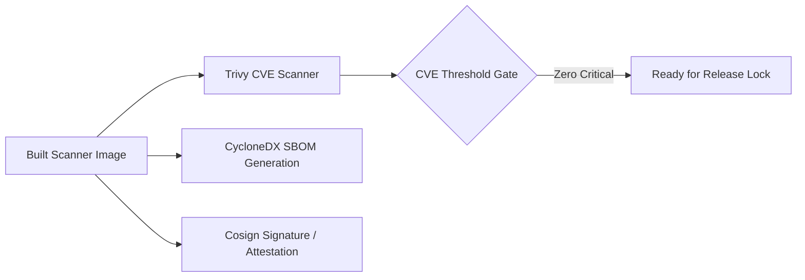

# EXEC-014 — Implement Scanner Image Vulnerability and Provenance Checks

**Milestone:** Scanner Execution Platform (Milestone #10)  
**Phase:** Phase 3 — Scanner Image Release and Certification  
**Issue ID:** `EXEC-014`  
**Priority:** `critical`  
**Status:** `ready-for-dev`  

---

## 🎯 Purpose

Extend scanner image verification with Trivy scanning, CycloneDX SBOMs, and Cosign provenance.

---

## 📐 Architecture & Workflow Diagram

---

## 📋 Detailed Requirements

- Run automated vulnerability scanning on scanner container images.
- Generate CycloneDX SBOM and build provenance records.
- Sign images and enforce signature verification prior to staging execution.

---

## ✅ Acceptance Criteria

- [ ] Every released image has an SBOM.
- [ ] Every released image has a build provenance record.
- [ ] Image signatures are verifiable.
- [ ] Critical vulnerability policy is enforced.
- [ ] Deployment rejects an image that fails release verification.
