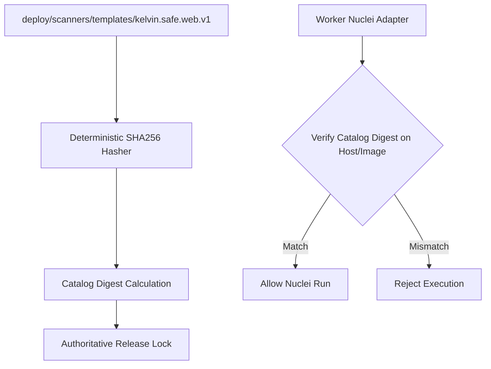

# EXEC-015 — Certify the Nuclei Curated Template Catalog

**Milestone:** Scanner Execution Platform (Milestone #10)  
**Phase:** Phase 3 — Scanner Image Release and Certification  
**Issue ID:** `EXEC-015`  
**Priority:** `critical`  
**Status:** `ready-for-dev`  

---

## 🎯 Purpose

Establish deterministic catalog digest generation and runtime catalog certification.

---

## 📐 Architecture & Workflow Diagram

---

## 📋 Detailed Requirements

- Define deterministic catalog hashing across all safe templates.
- Verify templates contain no invasive, DoS, or unapproved behavior.
- Embed catalog in image and verify digest at runtime; disable auto-updates and OAST.

---

## ✅ Acceptance Criteria

- [ ] Catalog digest is non-empty and mathematically correct.
- [ ] Every template hash matches.
- [ ] Unapproved templates fail validation.
- [ ] Runtime cannot silently load external templates.
- [ ] Nuclei runs only the approved catalog.
- [ ] Catalog identity appears in scanner provenance.
