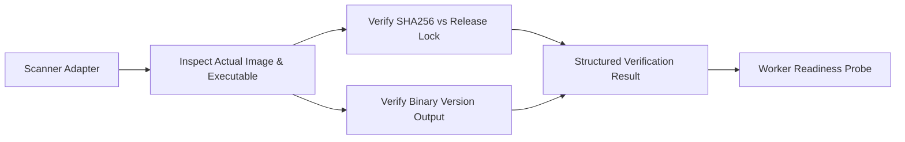

# EXEC-016 — Replace Hardcoded Scanner Runtime Verifiers

**Milestone:** Scanner Execution Platform (Milestone #10)  
**Phase:** Phase 3 — Scanner Image Release and Certification  
**Issue ID:** `EXEC-016`  
**Priority:** `critical`  
**Status:** `ready-for-dev`  

---

## 🎯 Purpose

Replace static/hardcoded scanner runtime verifiers with real cryptographic verification.

---

## 📐 Architecture & Workflow Diagram

---

## 📋 Detailed Requirements

- Inspect actual container image digests and binary versions at runtime.
- Verify Nuclei catalog digest dynamically.
- Surface verification failures to worker readiness probes.

---

## ✅ Acceptance Criteria

- [ ] A wrong image digest causes verification failure.
- [ ] A wrong executable version causes verification failure.
- [ ] A wrong catalog digest causes verification failure.
- [ ] No hardcoded verifier can mark an arbitrary runtime as certified.
- [ ] Provenance records reflect actual runtime measurements.
