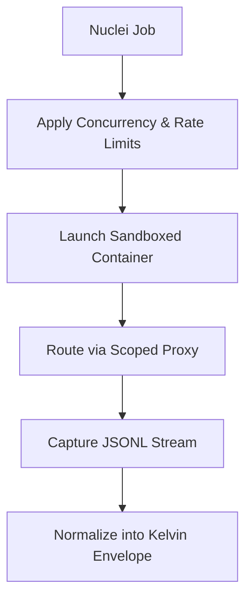

# EXEC-017 — Integrate Production Nuclei Scanner Execution

**Milestone:** Scanner Execution Platform (Milestone #10)  
**Phase:** Phase 4 — Nuclei and ZAP Integration  
**Issue ID:** `EXEC-017`  
**Priority:** `critical`  
**Status:** `ready-for-dev`  

---

## 🎯 Purpose

Complete production-ready Nuclei execution pipeline with rate limits, scoped egress, and JSONL capture.

---

## 📐 Architecture & Workflow Diagram

---

## 📋 Detailed Requirements

- Execute certified Nuclei image with curated template catalog.
- Disable auto-update and OAST; enforce rate limits and timeout.
- Normalize JSONL stream into canonical Kelvin finding envelope.

---

## ✅ Acceptance Criteria

- [ ] Nuclei executes only against authorized targets.
- [ ] Scanner uses the approved template set.
- [ ] Scanner output is parsed without data loss.
- [ ] Rate and timeout limits are enforced.
- [ ] Scanner errors are distinguishable from zero findings.
- [ ] End-to-end integration tests pass.
