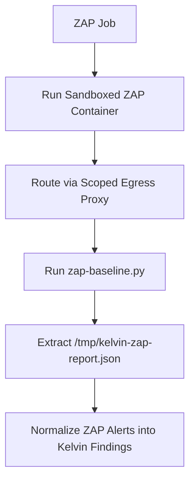

# EXEC-018 — Integrate Production OWASP ZAP Baseline Execution

**Milestone:** Scanner Execution Platform (Milestone #10)  
**Phase:** Phase 4 — Nuclei and ZAP Integration  
**Issue ID:** `EXEC-018`  
**Priority:** `critical`  
**Status:** `ready-for-dev`  

---

## 🎯 Purpose

Complete production-ready ZAP baseline execution with report extraction and finding normalization.

---

## 📐 Architecture & Workflow Diagram

---

## 📋 Detailed Requirements

- Execute certified ZAP baseline scan under strict scoped egress.
- Keep active scanning disabled; extract structured report via safe mechanism.
- Normalize ZAP alerts preserving risk, confidence, evidence, and CWE.

---

## ✅ Acceptance Criteria

- [ ] ZAP baseline executes successfully.
- [ ] Active scanning remains disabled.
- [ ] Out-of-scope requests are blocked.
- [ ] Reports are captured and validated.
- [ ] ZAP output is normalized into Kelvin's result envelope.
- [ ] Timeout and cancellation work.
