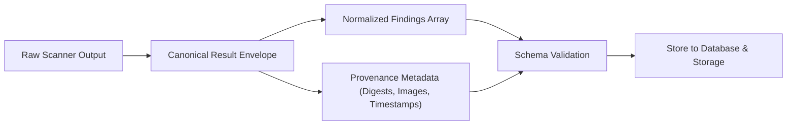

# EXEC-019 — Standardize Scanner Output and Provenance

**Milestone:** Scanner Execution Platform (Milestone #10)  
**Phase:** Phase 4 — Nuclei and ZAP Integration  
**Issue ID:** `EXEC-019`  
**Priority:** `critical`  
**Status:** `ready-for-dev`  

---

## 🎯 Purpose

Create consistent scanner result envelope and immutable provenance for all scanners.

---

## 📐 Architecture & Workflow Diagram

---

## 📋 Detailed Requirements

- Include TenantID, AssessmentID, JobID, ScannerID, digests, timings, findings, and errors.
- Ensure uniform structure across Nuclei, ZAP, and future scanners.
- Validate envelopes against schema before persistence.

---

## ✅ Acceptance Criteria

- [ ] Nuclei and ZAP emit the same top-level result envelope.
- [ ] Findings preserve scanner-specific details.
- [ ] Provenance is immutable after completion.
- [ ] Failed scans are not represented as successful empty scans.
- [ ] Schema validation runs before result persistence.
