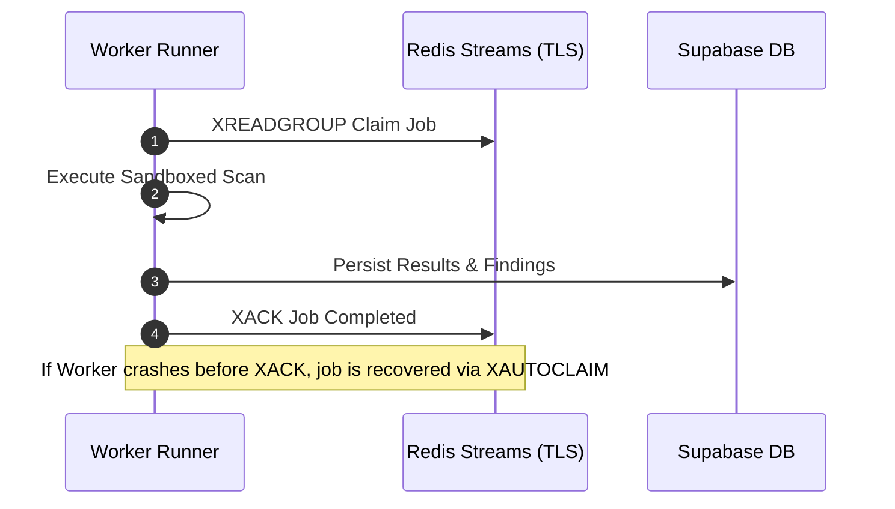

# EXEC-020 — Complete Worker Queue Lifecycle

**Milestone:** Scanner Execution Platform (Milestone #10)  
**Phase:** Phase 5 — Queue, Job Lifecycle and Persistence  
**Issue ID:** `EXEC-020`  
**Priority:** `critical`  
**Status:** `ready-for-dev`  

---

## 🎯 Purpose

Harden Redis stream queue processing, consumer groups, claims, and crash recovery.

---

## 📐 Architecture & Workflow Diagram

---

## 📋 Detailed Requirements

- Implement robust claim and acknowledgement semantics via Redis consumer groups.
- Implement dead-letter queueing and bounded retries.
- Prevent duplicate execution and safely recover interrupted jobs upon restart.

---

## ✅ Acceptance Criteria

- [ ] A job is not silently lost.
- [ ] A job is not acknowledged before successful persistence.
- [ ] Duplicate delivery does not duplicate completed results.
- [ ] Retry exhaustion moves a job to a terminal failure state.
- [ ] Worker restarts recover eligible jobs safely.
