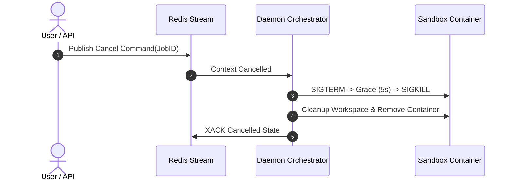

# EXEC-021 — Implement Cancellation, Deadlines and Idempotency

**Milestone:** Scanner Execution Platform (Milestone #10)  
**Phase:** Phase 5 — Queue, Job Lifecycle and Persistence  
**Issue ID:** `EXEC-021`  
**Priority:** `critical`  
**Status:** `ready-for-dev`  

---

## 🎯 Purpose

Make scanner execution safely cancellable, deadline-bounded, and idempotent.

---

## 📐 Architecture & Workflow Diagram

---

## 📋 Detailed Requirements

- Propagate cancellation signals from API through Redis to container executor.
- Enforce hard execution deadlines with 5s/10s grace periods before SIGKILL.
- Ensure idempotency and avoid duplicate findings upon retries.

---

## ✅ Acceptance Criteria

- [ ] Cancellation stops the actual container.
- [ ] Timed-out jobs become terminal.
- [ ] Retried jobs do not duplicate persisted findings.
- [ ] Interrupted jobs have deterministic recovery behavior.
- [ ] Cleanup is verified by integration tests.
