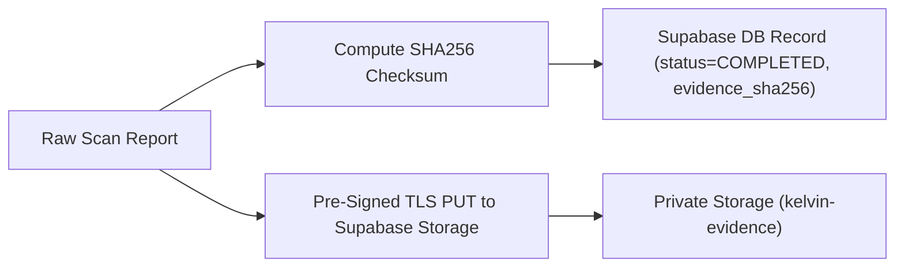

# EXEC-022 — Complete Evidence and Report Persistence

**Milestone:** Scanner Execution Platform (Milestone #10)  
**Phase:** Phase 5 — Queue, Job Lifecycle and Persistence  
**Issue ID:** `EXEC-022`  
**Priority:** `critical`  
**Status:** `ready-for-dev`  

---

## 🎯 Purpose

Connect scanner output to Supabase private storage and database persistence pipeline.

---

## 📐 Architecture & Workflow Diagram

---

## 📋 Detailed Requirements

- Store raw evidence in private kelvin-evidence bucket using tenant-scoped paths.
- Upload via short-lived pre-signed TLS URLs without exposing storage keys to runner.
- Verify checksum and ensure clean local scratch space.

---

## ✅ Acceptance Criteria

- [ ] Evidence upload and download work.
- [ ] Report upload and download work.
- [ ] Cross-tenant access is denied.
- [ ] Evidence hashes match uploaded content.
- [ ] No public bucket access is required.
- [ ] Storage failures are retriable without duplicating records.
