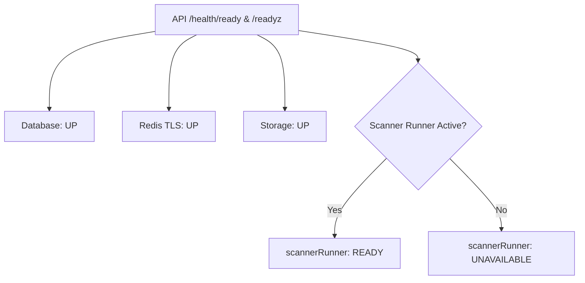

# EXEC-023 — Implement Truthful Scanner Readiness Reporting

**Milestone:** Scanner Execution Platform (Milestone #10)  
**Phase:** Phase 6 — Readiness, Observability and Recovery  
**Issue ID:** `EXEC-023`  
**Priority:** `high`  
**Status:** `ready-for-dev`  

---

## 🎯 Purpose

Replace generic scanner readiness with real runtime and adapter verification.

---

## 📐 Architecture & Workflow Diagram

---

## 📋 Detailed Requirements

- Verify runtime availability, queue connection, and scanner certification.
- Keep scannerRunner: UNAVAILABLE until verified worker is active.
- Ensure health probes do not leak internal credentials or sensitive data.

---

## ✅ Acceptance Criteria

- [ ] Scanner readiness becomes healthy only when all required checks pass.
- [ ] An unavailable scanner does not appear ready.
- [ ] API and worker readiness remain distinguishable.
- [ ] Health output contains no secrets.
- [ ] Readiness updates correctly after runtime failure.
