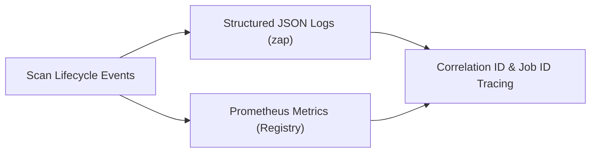

# EXEC-024 — Implement Structured Execution Observability

**Milestone:** Scanner Execution Platform (Milestone #10)  
**Phase:** Phase 6 — Readiness, Observability and Recovery  
**Issue ID:** `EXEC-024`  
**Priority:** `high`  
**Status:** `ready-for-dev`  

---

## 🎯 Purpose

Provide structured execution telemetry and metrics across API, worker, and proxy.

---

## 📐 Architecture & Workflow Diagram

---

## 📋 Detailed Requirements

- Emit structured JSON logs with correlation IDs for all job transitions.
- Track Prometheus metrics for job duration, resource usage, and egress violations.
- Ensure credentials, tokens, and target secrets are redacted.

---

## ✅ Acceptance Criteria

- [ ] Every execution can be traced by job ID and correlation ID.
- [ ] Metrics do not expose credentials or sensitive payloads.
- [ ] Logs are structured JSON.
- [ ] Failure reasons are actionable.
- [ ] Operational dashboards can distinguish queue, runtime and scanner failures.
