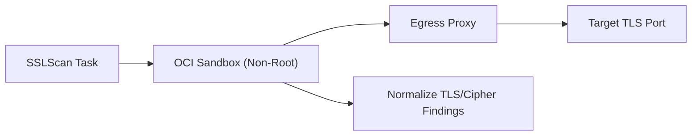

# EXEC-025 — Integrate SSLScan

**Milestone:** Scanner Execution Platform (Milestone #10)  
**Phase:** Phase 7 — Additional Scanner Integrations  
**Issue ID:** `EXEC-025`  
**Priority:** `high`  
**Status:** `ready-for-dev`  

---

## 🎯 Purpose

Integrate SSLScan tool into Kelvin sandbox and output envelope pipeline.

---

## 📐 Architecture & Workflow Diagram

---

## 📋 Detailed Requirements

- Pin immutable ARM64 image digest for SSLScan.
- Enforce port and target validation with scoped egress.
- Normalize ciphers, TLS versions, and certificate issues into Kelvin findings.

---

## ✅ Acceptance Criteria

- [ ] Only authorized targets are scanned.
- [ ] TLS findings use the common result schema.
- [ ] No unrestricted network access exists.
- [ ] Integration tests pass.
