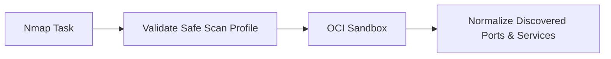

# EXEC-026 — Integrate Nmap

**Milestone:** Scanner Execution Platform (Milestone #10)  
**Phase:** Phase 7 — Additional Scanner Integrations  
**Issue ID:** `EXEC-026`  
**Priority:** `high`  
**Status:** `ready-for-dev`  

---

## 🎯 Purpose

Integrate Nmap with strict scan-profile restrictions and rate limiting.

---

## 📐 Architecture & Workflow Diagram

---

## 📋 Detailed Requirements

- Define approved, non-disruptive scan profiles (no arbitrary command flags).
- Validate target CIDRs and ports before execution.
- Normalize open ports and service banners into Kelvin finding format.

---

## ✅ Acceptance Criteria

- [ ] Nmap cannot execute arbitrary arguments.
- [ ] Target scope is validated before execution.
- [ ] Network policy is enforced.
- [ ] Findings are normalized.
- [ ] Unauthorized targets are rejected.
