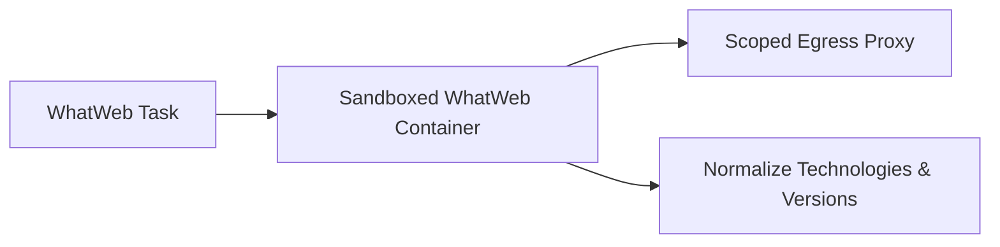

# EXEC-027 — Integrate WhatWeb

**Milestone:** Scanner Execution Platform (Milestone #10)  
**Phase:** Phase 7 — Additional Scanner Integrations  
**Issue ID:** `EXEC-027`  
**Priority:** `high`  
**Status:** `ready-for-dev`  

---

## 🎯 Purpose

Integrate WhatWeb for web technology fingerprinting under proxy egress.

---

## 📐 Architecture & Workflow Diagram

---

## 📋 Detailed Requirements

- Pin immutable image and enforce request limits.
- Route all requests through scoped egress proxy.
- Normalize technologies, versions, and headers into findings.

---

## ✅ Acceptance Criteria

- [ ] Only approved web targets are scanned.
- [ ] Scanner requests are rate-limited.
- [ ] Results use the common schema.
- [ ] Runtime identity is verified.
