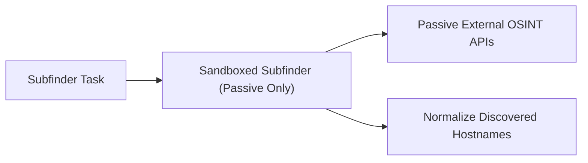

# EXEC-028 — Integrate Subfinder

**Milestone:** Scanner Execution Platform (Milestone #10)  
**Phase:** Phase 7 — Additional Scanner Integrations  
**Issue ID:** `EXEC-028`  
**Priority:** `high`  
**Status:** `ready-for-dev`  

---

## 🎯 Purpose

Integrate Subfinder for passive subdomain enumeration.

---

## 📐 Architecture & Workflow Diagram

---

## 📋 Detailed Requirements

- Enforce passive-only source mode (no active DNS brute forcing).
- Safely inject API keys from secret store without exposing in logs.
- Normalize discovered subdomains into tenant-scoped assets.

---

## ✅ Acceptance Criteria

- [ ] Passive-only behavior is enforced.
- [ ] Provider credentials never appear in logs.
- [ ] Results are tenant-scoped.
- [ ] All external requests follow approved egress rules.
