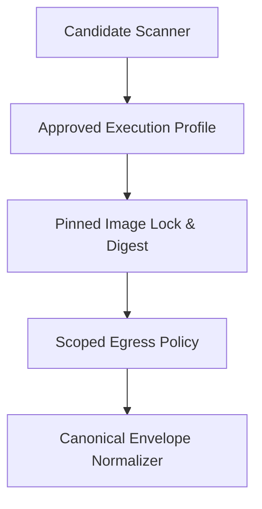

# EXEC-029 — Integrate Additional Approved Scanner Modules

**Milestone:** Scanner Execution Platform (Milestone #10)  
**Phase:** Phase 7 — Additional Scanner Integrations  
**Issue ID:** `EXEC-029`  
**Priority:** `high`  
**Status:** `ready-for-dev`  

---

## 🎯 Purpose

Establish reusable integration harness for candidate scanners (Nikto, Dirsearch, etc.).

---

## 📐 Architecture & Workflow Diagram

---

## 📋 Detailed Requirements

- Create reusable pattern for evaluating, containerizing, and sandboxing scanners.
- Require pinned digests, non-root execution, and scope validation for every tool.

---

## ✅ Acceptance Criteria

- [ ] Every scanner has an approved execution profile.
- [ ] Every scanner has a pinned image and version.
- [ ] Every scanner has a defined egress policy.
- [ ] Every scanner has a normalized result adapter.
- [ ] No scanner is exposed as operational before certification.
