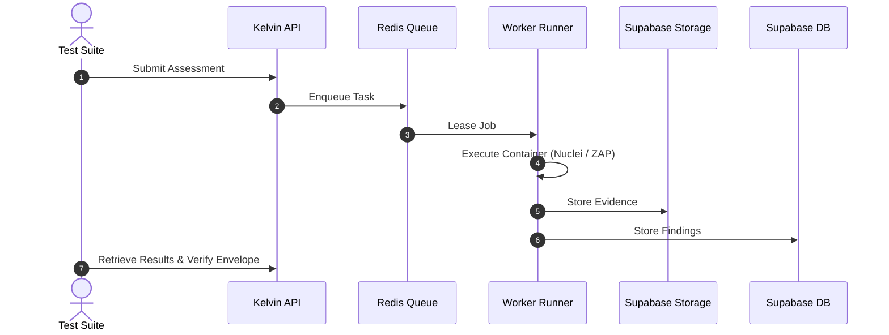

# EXEC-030 — Create Full Scanner End-to-End Test Suite

**Milestone:** Scanner Execution Platform (Milestone #10)  
**Phase:** Phase 8 — Staging Certification and Deployment  
**Issue ID:** `EXEC-030`  
**Priority:** `critical`  
**Status:** `ready-for-dev`  

---

## 🎯 Purpose

Validate the complete execution pipeline from assessment submission to result retrieval.

---

## 📐 Architecture & Workflow Diagram

---

## 📋 Detailed Requirements

- Create end-to-end tests for Nuclei and ZAP baseline against controlled targets.
- Test authorization rejections, timeout, cancellation, and Redis reconnects.
- Verify zero container or scratch workspace leaks.

---

## ✅ Acceptance Criteria

- [ ] Both Nuclei and ZAP complete end-to-end tests.
- [ ] Unauthorized target tests fail.
- [ ] Cancellation tests pass.
- [ ] Timeout tests pass.
- [ ] Redis recovery tests pass.
- [ ] Storage failure tests pass.
- [ ] No container or workspace is leaked.
