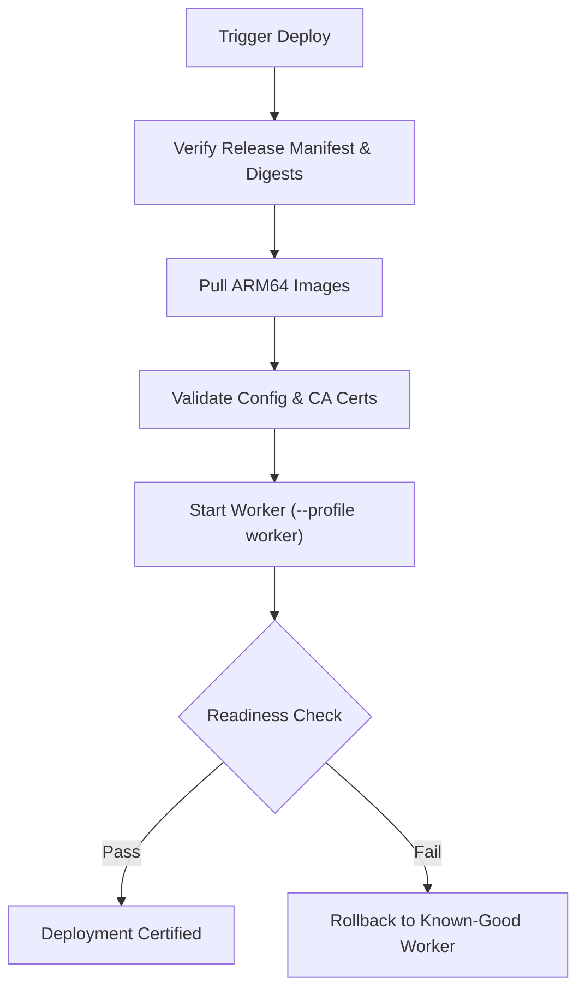

# EXEC-031 — Implement Staging Deployment and Rollback Automation

**Milestone:** Scanner Execution Platform (Milestone #10)  
**Phase:** Phase 8 — Staging Certification and Deployment  
**Issue ID:** `EXEC-031`  
**Priority:** `critical`  
**Status:** `ready-for-dev`  

---

## 🎯 Purpose

Create repeatable staging deployment and rollback procedure for worker and scanner images.

---

## 📐 Architecture & Workflow Diagram

---

## 📋 Detailed Requirements

- Verify manifests, signatures, and ARM64 architecture before starting worker.
- Automate smoke testing and health verification upon deployment.
- Support clean rollback to prior stable version on failure.

---

## ✅ Acceptance Criteria

- [ ] Deployment is repeatable.
- [ ] Previous working API remains unaffected.
- [ ] Scanner worker is not activated before verification.
- [ ] Rollback restores the previous worker version.
- [ ] Deployment evidence is retained.
