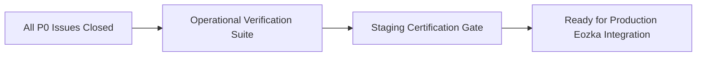

# EXEC-032 — Complete Kelvin Staging Operational Certification

**Milestone:** Scanner Execution Platform (Milestone #10)  
**Phase:** Phase 8 — Staging Certification and Deployment  
**Issue ID:** `EXEC-032`  
**Priority:** `critical`  
**Status:** `ready-for-dev`  

---

## 🎯 Purpose

Perform final operational certification before integrating Kelvin into the main Eozka site.

---

## 📐 Architecture & Workflow Diagram

---

## 📋 Detailed Requirements

- Verify API/Worker health, Redis TLS, DB connectivity, and storage lifecycle.
- Verify OCI runtime on ARM64, catalog integrity, and network bypass defenses.
- Record formal release decision and approval.

---

## ✅ Acceptance Criteria

- [ ] All P0 issues are closed.
- [ ] All mandatory security tests pass.
- [ ] Both scanner integrations are operational.
- [ ] No scanner is marked ready without certification.
- [ ] Deployment and rollback procedures are documented.
- [ ] Release approval is recorded.
