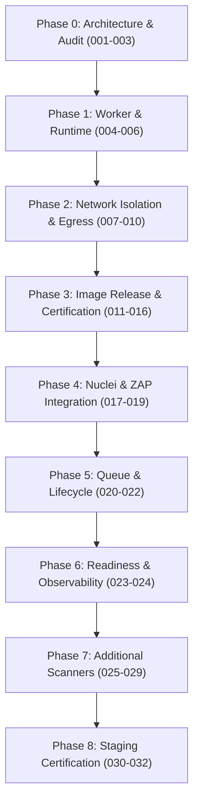

# Milestone 10 — Kelvin Scanner Execution Platform

**Milestone:** Scanner Execution Platform (Milestone #10)  
**Status:** In Progress (Phase 0 Under Review)  
**Target Environment:** Oracle Linux Server 9.8, ARM64 / aarch64 (2 vCPUs, 10 GiB RAM)  
**Governing Architecture Decision:** [ADR-0008: Secure OCI Execution Architecture](../../../docs/architecture/decisions/ADR-0008.md)  

---

## 🏆 Overview

This implementation backlog provides the formal, secure OCI scanner execution platform for KELVIN across 32 engineering issues organized into 9 release phases.

---

## 📋 Backlog & GitHub Issues Matrix

| Issue ID | GitHub Issue | Title | Phase | Priority | Local Specification |
| :--- | :--- | :--- | :--- | :--- | :--- |
| **EXEC-001** | [#488](https://github.com/eOzkull/Kelvin/issues/488) | Define the Secure OCI Execution Architecture | Phase 0 | P0 Critical | [EXEC-001](EXEC-001_DEFINE_THE_SECURE_OCI_EXECUTION_ARCHITECTURE.md) |
| **EXEC-002** | [#489](https://github.com/eOzkull/Kelvin/issues/489) | Define Scanner Execution and Security Contracts | Phase 0 | P0 Critical | [EXEC-002](EXEC-002_DEFINE_SCANNER_EXECUTION_AND_SECURITY_CONTRACTS.md) |
| **EXEC-003** | [#490](https://github.com/eOzkull/Kelvin/issues/490) | Reconcile Scanner Image and Template Release Manifests | Phase 0 | P0 Critical | [EXEC-003](EXEC-003_RECONCILE_SCANNER_IMAGE_AND_TEMPLATE_RELEASE_MANIFESTS.md) |
| **EXEC-004** | [#491](https://github.com/eOzkull/Kelvin/issues/491) | Implement the Approved ARM64 OCI Runtime | Phase 1 | P0 Critical | [EXEC-004](EXEC-004_IMPLEMENT_THE_APPROVED_ARM64_OCI_RUNTIME.md) |
| **EXEC-005** | [#492](https://github.com/eOzkull/Kelvin/issues/492) | Implement Scanner Container Lifecycle Management | Phase 1 | P0 Critical | [EXEC-005](EXEC-005_IMPLEMENT_SCANNER_CONTAINER_LIFECYCLE_MANAGEMENT.md) |
| **EXEC-006** | [#493](https://github.com/eOzkull/Kelvin/issues/493) | Implement Worker Configuration and Certificate Handling | Phase 1 | P0 Critical | [EXEC-006](EXEC-006_IMPLEMENT_WORKER_CONFIGURATION_AND_CERTIFICATE_HANDLING.md) |
| **EXEC-007** | [#494](https://github.com/eOzkull/Kelvin/issues/494) | Implement Scanner-Only Internal Network Isolation | Phase 2 | P0 Critical | [EXEC-007](EXEC-007_IMPLEMENT_SCANNER_ONLY_INTERNAL_NETWORK_ISOLATION.md) |
| **EXEC-008** | [#495](https://github.com/eOzkull/Kelvin/issues/495) | Fix Egress Proxy Endpoint Accessibility | Phase 2 | P0 Critical | [EXEC-008](EXEC-008_FIX_EGRESS_PROXY_ENDPOINT_ACCESSIBILITY.md) |
| **EXEC-009** | [#496](https://github.com/eOzkull/Kelvin/issues/496) | Enforce Proxy-Only Egress for Nuclei and ZAP | Phase 2 | P0 Critical | [EXEC-009](EXEC-009_ENFORCE_PROXY_ONLY_EGRESS_FOR_NUCLEI_AND_ZAP.md) |
| **EXEC-010** | [#497](https://github.com/eOzkull/Kelvin/issues/497) | Add Network Bypass and Isolation Regression Tests | Phase 2 | P0 Critical | [EXEC-010](EXEC-010_ADD_NETWORK_BYPASS_AND_ISOLATION_REGRESSION_TESTS.md) |
| **EXEC-011** | [#498](https://github.com/eOzkull/Kelvin/issues/498) | Rebuild the Scanner Image Pipeline for ARM64 | Phase 3 | P0 Critical | [EXEC-011](EXEC-011_REBUILD_THE_SCANNER_IMAGE_PIPELINE_FOR_ARM64.md) |
| **EXEC-012** | [#499](https://github.com/eOzkull/Kelvin/issues/499) | Publish Scanner Images to GHCR | Phase 3 | P0 Critical | [EXEC-012](EXEC-012_PUBLISH_SCANNER_IMAGES_TO_GHCR.md) |
| **EXEC-013** | [#500](https://github.com/eOzkull/Kelvin/issues/500) | Repair Scanner Image Workflow Gating | Phase 3 | P0 Critical | [EXEC-013](EXEC-013_REPAIR_SCANNER_IMAGE_WORKFLOW_GATING.md) |
| **EXEC-014** | [#501](https://github.com/eOzkull/Kelvin/issues/501) | Implement Scanner Image Vulnerability and Provenance Checks | Phase 3 | P0 Critical | [EXEC-014](EXEC-014_IMPLEMENT_SCANNER_IMAGE_VULNERABILITY_AND_PROVENANCE_CHECKS.md) |
| **EXEC-015** | [#502](https://github.com/eOzkull/Kelvin/issues/502) | Certify the Nuclei Curated Template Catalog | Phase 3 | P0 Critical | [EXEC-015](EXEC-015_CERTIFY_THE_NUCLEI_CURATED_TEMPLATE_CATALOG.md) |
| **EXEC-016** | [#503](https://github.com/eOzkull/Kelvin/issues/503) | Replace Hardcoded Scanner Runtime Verifiers | Phase 3 | P0 Critical | [EXEC-016](EXEC-016_REPLACE_HARDCODED_SCANNER_RUNTIME_VERIFIERS.md) |
| **EXEC-017** | [#504](https://github.com/eOzkull/Kelvin/issues/504) | Integrate Production Nuclei Scanner Execution | Phase 4 | P0 Critical | [EXEC-017](EXEC-017_INTEGRATE_PRODUCTION_NUCLEI_SCANNER_EXECUTION.md) |
| **EXEC-018** | [#505](https://github.com/eOzkull/Kelvin/issues/505) | Integrate Production OWASP ZAP Baseline Execution | Phase 4 | P0 Critical | [EXEC-018](EXEC-018_INTEGRATE_PRODUCTION_OWASP_ZAP_BASELINE_EXECUTION.md) |
| **EXEC-019** | [#506](https://github.com/eOzkull/Kelvin/issues/506) | Standardize Scanner Output and Provenance | Phase 4 | P0 Critical | [EXEC-019](EXEC-019_STANDARDIZE_SCANNER_OUTPUT_AND_PROVENANCE.md) |
| **EXEC-020** | [#507](https://github.com/eOzkull/Kelvin/issues/507) | Complete Worker Queue Lifecycle | Phase 5 | P0 Critical | [EXEC-020](EXEC-020_COMPLETE_WORKER_QUEUE_LIFECYCLE.md) |
| **EXEC-021** | [#508](https://github.com/eOzkull/Kelvin/issues/508) | Implement Cancellation, Deadlines and Idempotency | Phase 5 | P0 Critical | [EXEC-021](EXEC-021_IMPLEMENT_CANCELLATION_DEADLINES_AND_IDEMPOTENCY.md) |
| **EXEC-022** | [#509](https://github.com/eOzkull/Kelvin/issues/509) | Complete Evidence and Report Persistence | Phase 5 | P0 Critical | [EXEC-022](EXEC-022_COMPLETE_EVIDENCE_AND_REPORT_PERSISTENCE.md) |
| **EXEC-023** | [#510](https://github.com/eOzkull/Kelvin/issues/510) | Implement Truthful Scanner Readiness Reporting | Phase 6 | P1 High | [EXEC-023](EXEC-023_IMPLEMENT_TRUTHFUL_SCANNER_READINESS_REPORTING.md) |
| **EXEC-024** | [#511](https://github.com/eOzkull/Kelvin/issues/511) | Implement Structured Execution Observability | Phase 6 | P1 High | [EXEC-024](EXEC-024_IMPLEMENT_STRUCTURED_EXECUTION_OBSERVABILITY.md) |
| **EXEC-025** | [#512](https://github.com/eOzkull/Kelvin/issues/512) | Integrate SSLScan | Phase 7 | P1 High | [EXEC-025](EXEC-025_INTEGRATE_SSLSCAN.md) |
| **EXEC-026** | [#513](https://github.com/eOzkull/Kelvin/issues/513) | Integrate Nmap | Phase 7 | P1 High | [EXEC-026](EXEC-026_INTEGRATE_NMAP.md) |
| **EXEC-027** | [#514](https://github.com/eOzkull/Kelvin/issues/514) | Integrate WhatWeb | Phase 7 | P1 High | [EXEC-027](EXEC-027_INTEGRATE_WHATWEB.md) |
| **EXEC-028** | [#515](https://github.com/eOzkull/Kelvin/issues/515) | Integrate Subfinder | Phase 7 | P1 High | [EXEC-028](EXEC-028_INTEGRATE_SUBFINDER.md) |
| **EXEC-029** | [#516](https://github.com/eOzkull/Kelvin/issues/516) | Integrate Additional Approved Scanner Modules | Phase 7 | P1 High | [EXEC-029](EXEC-029_INTEGRATE_ADDITIONAL_APPROVED_SCANNER_MODULES.md) |
| **EXEC-030** | [#517](https://github.com/eOzkull/Kelvin/issues/517) | Create Full Scanner End-to-End Test Suite | Phase 8 | P0 Critical | [EXEC-030](EXEC-030_CREATE_FULL_SCANNER_END_TO_END_TEST_SUITE.md) |
| **EXEC-031** | [#518](https://github.com/eOzkull/Kelvin/issues/518) | Implement Staging Deployment and Rollback Automation | Phase 8 | P0 Critical | [EXEC-031](EXEC-031_IMPLEMENT_STAGING_DEPLOYMENT_AND_ROLLBACK_AUTOMATION.md) |
| **EXEC-032** | [#519](https://github.com/eOzkull/Kelvin/issues/519) | Complete Kelvin Staging Operational Certification | Phase 8 | P0 Critical | [EXEC-032](EXEC-032_COMPLETE_KELVIN_STAGING_OPERATIONAL_CERTIFICATION.md) |
