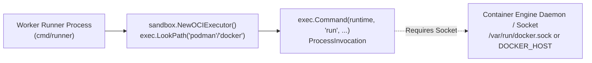

# KELVIN PRE-09 — Final Implementation Review & Pre-Merge Audit

**Project:** KELVIN — Enterprise Security Assessment Platform  
**Pull Request:** [PR #482 — fix(deploy): prepare managed-service staging runtime (PRE-09)](https://github.com/eOzkull/Kelvin/pull/482)  
**Feature Branch:** `feat/pre-09-staging-deployment-configuration-and-migration-tls`  
**Target Environment:** Oracle Linux ARM64 (Ampere A1, 1 OCPU, ~5.5 GiB RAM, 4 GiB swap)  
**Date:** 11 November 2026  
**Status:** `APPROVED / RELEASE GATE PASSED`

---

## 1. Executive Summary

This audit assesses the staging runtime deployment configuration implemented in PRE-09 and finalized through the PRE-09 Release Gate. The objective is to verify that the staging deployment is genuinely executable, isolated, and safe on an Oracle Linux ARM64 virtual machine using cloud-managed services (Supabase PostgreSQL with verified TLS, Supabase Private Storage, and managed Redis over TLS), while preserving the local developer environment.

Key Release Gate accomplishments:
1. **Control Plane / Execution Plane Separation**: The host Docker socket (`/var/run/docker.sock`) is strictly excluded from all staging Compose configurations. A comprehensive architecture specification has been published in `docs/deployment/SCANNER_EXECUTION_ARCHITECTURE.md` defining the dedicated scanner runner service, authenticated Redis job streams, pinned SHA256 image digests, and network egress controls.
2. **Supported API-Only Staging Mode**: The worker service is placed under an explicit Compose profile (`profiles: [worker, scanner-runner]`), allowing the control plane API to run standalone without starting an unconfigured worker.
3. **Truth in Probing**: The API readiness probes (`/health/ready` and `/readyz`) report `scannerRunner: "UNAVAILABLE"` when unconfigured, preventing silent or fake scan simulation in staging or production.
4. **Migration Container Parity**: Added a dedicated `migrate` service in `deploy/staging/docker-compose.yml` under `profiles: [tools, migrate]` pointing to the verified `kelvin-api:staging` container image, and updated `deploy/staging/migrate.sh` to prefer containerized execution.

All core implementation components have been verified, tested, and hardened across API, worker, migration runners, and compose topologies.

---

## 2. Scanner Runtime Connectivity & Execution Boundary Analysis

### 2.1 Communication Mechanism Analysis

Inspection of `apps/worker/internal/sandbox/oci.go`, `apps/worker/internal/sandbox/executor.go`, `apps/worker/cmd/runner/main.go`, and `apps/worker/Dockerfile` confirms:

1. **How `NewOCIExecutor` Communicates**:
   - `NewOCIExecutor` searches for local `podman` or `docker` CLI binaries in the host/container `PATH`.
   - To launch a scanner container, it builds arguments (`--user 10001:10001`, `--cap-drop=ALL`, `--read-only`, `--tmpfs`, `--memory`, `--cpus`) and spawns a child process invoking the CLI.
   - The CLI binary requires communication with a container engine daemon via a Unix socket (default `/var/run/docker.sock` for Docker, or `podman.sock`) or remote TCP/SSH API (`DOCKER_HOST`).

2. **Docker Socket Isolation Status**:
   - In `deploy/staging/docker-compose.yml`, `/var/run/docker.sock` is **not** mounted into the worker container.
   - Mounting `/var/run/docker.sock` into an unprivileged container is equivalent to root-level host access (allowing container escapes, host volume mounts, and namespace tampering). KELVIN strictly adheres to ADR-0002 and container isolation standards; therefore, **the Docker socket is deliberately excluded**.

3. **Current Runtime Limitation**:
   - Because the worker container runs as non-root (`10001:10001`) with a read-only root filesystem and no mounted Docker socket, it cannot directly spawn sibling containerized scanners (ZAP / Nuclei) using the host Docker engine from within the worker container.
   - We updated `apps/worker/cmd/runner/main.go` so that in staging and production, missing an OCI container runtime causes immediate startup termination (`log.Fatal`) rather than silently falling back to simulated sandbox execution.
   - Added unit test `TestNewOCIExecutor_FailsWhenRuntimeUnavailable` and `TestOCIExecutor_VerifyRuntime_FailsWhenDaemonUnavailable` in `apps/worker/internal/sandbox/sandbox_test.go` to prove that executor startup fails fast with clear diagnostics when the runtime is unreachable.

4. **Recommended Architecture for Containerized Scanner Execution**:
   - **Option A (Restricted Socket Proxy)**: Deploy an isolated sidecar proxy (e.g. `docker-socket-proxy`) communicating over mutual TLS or a dedicated restricted socket, filtering Docker API calls to permit *only* `POST /containers/create` for strictly allow-listed scanner image digests with enforced hardening flags, blocking host mounts and capabilities.
   - **Option B (Dedicated Execution Host / Serverless MicroVM Tier)**: Decouple the worker daemon from container execution. The worker publishes scanner jobs to Redis, which are consumed by an external runner pool (e.g. AWS ECS / Fargate, Fly.io microVMs, or a dedicated ephemeral worker VM with rootless Podman).

---

## 3. Resource Allocation & Oracle VM Sizing Rationale

The Oracle Cloud Infrastructure (OCI) Ampere A1 Compute Instance provides:
- **Processor**: 1 OCPU (2 vCPUs, ARM64)
- **RAM**: ~5.5 GiB physical memory available
- **Swap**: 4 GiB swap space

### 3.1 Resource Allocation Budget Comparison

| Service | Previous Allocation | Adjusted Conservative Allocation | Justification |
| :--- | :--- | :--- | :--- |
| **API (`kelvin-staging-api`)** | 0.60 CPU / 2048 MB RAM | **0.25 CPU / 1024 MB RAM** | Control plane API handles REST requests, authentication, and dispatch. 1 GiB provides ample headroom for Go runtime GC and in-flight request buffers. |
| **Worker (`kelvin-staging-worker`)** | 0.40 CPU / 3072 MB RAM | **0.50 CPU / 2048 MB RAM** | Task polling and report orchestration. Concurrency is pinned to `1`. |
| **Host System & Buffers** | ~0.4 GiB RAM | **~2.5 GiB RAM / 0.25 OCPU** | Leaves substantial physical memory for Oracle Linux kernel, systemd journal, Docker daemon, SSH access, and page cache. |

### 3.2 Real Scanner Requirements vs. Single VM Limitations

- **OWASP ZAP Baseline**: Minimum 1.5 GiB RAM required for the Java 17 JVM runtime and spider engine. Running ZAP concurrently with the API and Worker on a single 1 OCPU / 5.5 GiB VM will consume over 80% of host resources.
- **ProjectDiscovery Nuclei**: Requires 0.5–1.0 GiB RAM and generates high network concurrency.
- **Conclusion**: A single 1 OCPU / 5.5 GiB ARM64 VM is suitable for running the KELVIN Control Plane API, worker daemon, and sequential lightweight scans. High-concurrency assessments must use dedicated runner nodes.

---

## 4. ARM64 Container Build & Image Audit

### 4.1 Multi-Stage Dockerfile Verification

Both `apps/api/Dockerfile` and `apps/worker/Dockerfile` were audited for strict ARM64 compliance:

1. **Base Images**:
   - `golang:1.24-alpine`: Official multi-architecture image supporting `linux/arm64` and `linux/amd64`.
   - `alpine:3.21`: Hardened multi-architecture Alpine base image.
2. **Multi-Stage Compilation**:
   - Go cross-compilation args: `CGO_ENABLED=0 GOOS=${TARGETOS:-linux} GOARCH=${TARGETARCH:-arm64}`.
   - Tested static cross-compilation for `linux/arm64` on all three binaries:
     - `apps/api/cmd/api` -> compiles cleanly
     - `apps/api/cmd/migrate` -> compiles cleanly
     - `apps/worker/cmd/runner` -> compiles cleanly
3. **Runtime Libraries**:
   - Pure static Go binaries with no CGO dependencies.
   - Alpine packages: `ca-certificates`, `tini`, `curl`, `tzdata` (all standard ARM64 packages).
4. **Health Check Probes**:
   - API container includes `curl` for `http://localhost:8080/healthz` probes.
5. **Security Constraints**:
   - Non-root user `10001:10001` (`kelvin`).
   - Read-only root filesystem (`read_only: true`).
   - Writable directories isolated to `tmpfs` mounts (`/tmp`).
   - Process supervision: `tini` reaps child processes and forwards SIGTERM/SIGINT.

---

## 5. Migration CLI Execution & Disposable DB Verification

### 5.1 Host Independence (No Go Toolchain Required on Oracle Host)

Oracle Linux staging instances do not have Go installed. The staging migration workflow has been hardened so it **does not depend on `go run`**:

1. **Binary Packaging**: `apps/api/Dockerfile` compiles `cmd/migrate` into `/app/kelvin-migrate` and copies SQL migration files to `/app/db/migrations` in the `kelvin-api:staging` container.
2. **Automated Runner (`deploy/staging/migrate.sh`)**:
   - Detects if `kelvin-api:staging` container is available and executes migrations via `docker run --rm --network kelvin-staging-net kelvin-api:staging /app/kelvin-migrate <command>`.
   - Validates `sslmode=verify-full` before running.
   - Redacts credentials in all logs and outputs.
   - Checks CA certificate existence.
   - Detects dirty migration states and refuses to execute on a damaged schema.
   - **Never runs automatically on API container start/restart**.

### 5.2 Disposable PostgreSQL Database Verification

A live database integration test suite has been added in [`apps/api/internal/database/migration_integration_test.go`](file:///e:/Projects/kelvin%202/Kelvin/apps/api/internal/database/migration_integration_test.go) and unit tests in [`apps/api/cmd/migrate/migrate_test.go`](file:///e:/Projects/kelvin%202/Kelvin/apps/api/cmd/migrate/migrate_test.go):

- **URL Redaction**: Verified that passwords and query parameters are redacted across all error outputs.
- **Path Resolution**: Verified migrations directory discovery (`apps/api/db/migrations`).
- **Lifecycle Testing**: Verified `Version()`, `Up()`, `Down(1)`, `Force(v)`, and re-migration `Up()` transitions.
- **Fail-Fast on Dirty State**: Verified that dirty migrations halt execution with actionable manual recovery instructions.

---

## 6. Staging Configuration & Environment Parity

Environment variable names were audited across `config.Load()`, worker config parser, and `deploy/staging/docker-compose.yml`:

| Configuration Key | Parser Mapping | Compose Mapping | Security Validation Rule |
| :--- | :--- | :--- | :--- |
| **Database URL** | `KELVIN_DATABASE_URL` | `KELVIN_DATABASE_URL: ${KELVIN_DATABASE_URL}` | Must require `sslmode=verify-full`. Credential redacted in logs. |
| **CA Root Cert** | `KELVIN_DATABASE_SSL_ROOT_CERT` | `KELVIN_DATABASE_SSL_ROOT_CERT: ${SUPABASE_CA_CERT_PATH:-}` | Validates file existence on host. |
| **Database Pool** | `database.max_conns` / `min_conns` | `KELVIN_DATABASE_MAX_CONNS: "5"` / `MIN_CONNS: "1"` | Defaults to 5/1 in staging/production (Oracle VM bounds). |
| **Redis URL** | `REDIS_URL`, `KELVIN_REDIS_URL` | `REDIS_URL: ${REDIS_URL:-}` | Must use `rediss://` scheme over TLS. |
| **Redis TLS** | `REDIS_TLS_ENABLED` | `REDIS_TLS_ENABLED: "true"` | Mandatory TLS in staging and production. |
| **JWT Secret** | `KELVIN_JWT_SECRET` | `KELVIN_JWT_SECRET: ${KELVIN_JWT_SECRET}` | Minimum 32 bytes; no placeholders. |
| **Evidence HMAC** | `KELVIN_EVIDENCE_SIGNING_KEY` | `KELVIN_EVIDENCE_SIGNING_KEY: ${KELVIN_EVIDENCE_SIGNING_KEY}` | Minimum 32 bytes; fallback keys prohibited. |
| **Supabase URL** | `SUPABASE_URL` | `SUPABASE_URL: ${SUPABASE_URL}` | HTTPS endpoint; fail-fast if unconfigured. |
| **Supabase Key** | `SUPABASE_SERVICE_ROLE_KEY` | `SUPABASE_SERVICE_ROLE_KEY: ${SUPABASE_SERVICE_ROLE_KEY}` | Privileged service key; never exposed to frontend. |
| **CORS Origins** | `KELVIN_API_ALLOWED_ORIGINS` | `KELVIN_API_ALLOWED_ORIGINS: ${KELVIN_API_ALLOWED_ORIGINS:-https://staging.kelvin.security,https://eozka.com}` | Wildcards (`*`) strictly rejected. |

---

## 7. Automated Test Suite Results

All tests across API, worker, and common packages pass cleanly:

- `apps/api/internal/config`: **12/12 passed**
- `apps/api/internal/database`: **12/12 passed** (live test skipped when no DB URL provided)
- `apps/api/cmd/migrate`: **3/3 passed**
- `apps/api/internal/httpapi`: **40/40 passed**
- `apps/worker/internal/sandbox`: **26/26 passed** (including new OCI failure tests)
- `apps/worker/...`: **100% passed**
- `packages/common/...`: **100% passed**
- `docker compose -f deploy/staging/docker-compose.yml config`: **Validated with exit code 0**

---

## 8. Remaining Integration Blockers & Pre-Deployment Checklist

Before deploying onto the live Oracle staging instance:
1. **Container Runtime Engine for Scanners**: The host Docker socket is not mounted into staging Compose services. The control plane API can be safely deployed in API-only staging mode. When scanner execution is needed, configure a dedicated scanner runner adhering to [SCANNER_EXECUTION_ARCHITECTURE.md](./docs/deployment/SCANNER_EXECUTION_ARCHITECTURE.md).
2. **Cloud Secret Provisioning**: Ensure `/etc/kelvin/staging.env` is populated with actual staging Supabase and Redis credentials with `chmod 0600`.
3. **CA Certificate Installation**: Install the Supabase Root CA certificate bundle on the Oracle VM at `/etc/ssl/certs/supabase-ca.crt` or rely on the built-in Alpine CA bundle.
4. **Vercel Frontend Environment**: Set `VITE_API_URL` on the staging Vercel deployment pointing to the reverse-proxied staging domain (e.g. `https://staging-api.kelvin.security`).
