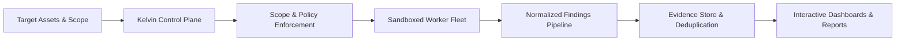

# Kelvin

> **Kelvin** is an enterprise-grade, modular security assessment and vulnerability management platform designed for authorized security assessments. It provides a unified orchestration environment for asset inventory, strict target scope enforcement, modular scan execution, normalized findings analysis, and executive reporting.

---

## 📌 Core Architecture & Features Overview

Kelvin eliminates the operational fragmentation of manual security scanners by centralizing assessment policies and executing scans within sandboxed, anti-SSRF worker environments.

### Key Capabilities
- **Strict Target Scope Validation:** Prevents scanning prohibited destinations (RFC 1918, loopbacks, link-local, cloud metadata) and mitigates DNS rebinding attacks.
- **Asynchronous Scan Orchestration:** Event-driven job processing with deterministic state machines and worker sandboxing.
- **Canonical Finding Normalization:** Unifies diverse scanner outputs into a consistent, actionable vulnerability schema with automated deduplication and credential redaction.
- **Defense-in-Depth Architecture:** Multi-tier separation between the user-facing web dashboard, API control plane, message broker, and ephemeral scanner workers.

---

## 📚 Project Documentation & Governance

The platform engineering specifications are organized into foundational documents:

1. **[Architectural Design & Features](docs/ARCHITECTURE_AND_FEATURES.md):** Detailed system components, communication channels, network boundaries, and scan lifecycle sequences.
2. **[Engineering Roadmap & Milestones](docs/ROADMAP.md):** 225-issue trajectory across 6 evolutionary phases, Gantt schedules, and Trunk-based Git branching strategy.
3. **[MVP Definition & Phase Bifurcation](docs/MVP_AND_PHASE_BIFURCATION.md):** Scope boundaries (MVP vs. Future vs. Non-Goals), Core Domain Entity-Relationship Diagram (ERD), and assessment job state machine.

---

## 🚀 Roadmap & Milestones

Development is tracked via GitHub Milestones:
- **Phase 1 — Foundation & Core Architecture (`P1-01` to `P1-25`)** *(In Progress)*:
  - Establishing project vision, acceptable-use policy, and initial threat model.
  - Designing API contracts, persistence foundations, and background job queue abstraction.
  - Implementing centralized target validation and anti-SSRF scope enforcement layer.
- **Phase 2 — Scanner Engines & Worker Isolation (`P2-26` to `P2-65`)**
- **Phase 3 — Findings Pipeline & Risk Intelligence (`P3-66` to `P3-110`)**
- **Phase 4 — Multi-Tenancy & Enterprise Governance (`P4-111` to `P4-150`)**
- **Phase 5 — Continuous Assessment & Automation (`P5-151` to `P5-185`)**
- **Phase 6 — Extensibility & Advanced Analytics (`P6-186` to `P6-225`)**

---

## 🛡️ Security & Responsible Use

Kelvin is explicitly engineered for **authorized assessments only**. Scanning arbitrary or unauthorized third-party infrastructure without explicit authorization is strictly prohibited. The platform incorporates built-in scope verification to prevent unconstrained scanning.
