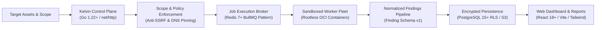

# Kelvin

[](LICENSE)
[](#roadmap--milestones)
[](#core-architecture--technology-stack)

> **Kelvin** is an enterprise-grade, modular security assessment and vulnerability management platform designed exclusively for authorized assessments. It provides a unified orchestration environment for asset inventory, strict target scope enforcement, modular scan execution, normalized findings analysis, and executive reporting.

---

## 📌 Core Architecture & Technology Stack

Kelvin eliminates the operational fragmentation of manual security scanners by centralizing assessment policies and executing scans within sandboxed, anti-SSRF worker environments.



### Architectural Decisions (ADR Summary)
- **Backend Control Plane (ADR-0001):** Implemented in **Go 1.22+** utilizing the Go standard library `net/http` as the primary HTTP framework, `go.uber.org/zap` for structured logging, and `spf13/viper` for centralized configuration.
- **Relational Persistence Layer (ADR-0002):** Built on **PostgreSQL 15+** with database-level Row-Level Security (RLS) enforcing tenant isolation (`tenant_id = current_tenant_id()`), connection pooling via `jackc/pgx/v5`, and versioned SQL migrations managed via `golang-migrate`.
- **Distributed Job Queue & Execution Broker (ADR-0003):** Backed by **Redis 7+** implementing a BullMQ-compatible execution queue pattern with AOF persistence, short-lived worker lease tokens, and PostgreSQL state reconciliation.
- **Frontend SPA Architecture (ADR-0004):** **React 18+ (SPA)** with **TypeScript**, built via **Vite**, styled with **Tailwind CSS** and accessible primitives (Radix UI / shadcn), and managed via **TanStack Query** for server state.
- **Scanner Worker Sandboxing (ADR-0005):** Disposable, unprivileged **Rootless OCI Containers** (Docker/Podman) executing with non-root UID, read-only root filesystems (`noexec` tmpfs), custom seccomp/AppArmor profiles, and strict egress proxies blocking RFC 1918 and cloud metadata (`169.254.169.254`).

---

## 📚 Project Documentation & Governance

The platform engineering specifications are organized into canonical documentation:

1. **[Product Vision & Scope](docs/PRODUCT_VISION.md) (`P1-01`):** Core problem statement, user personas, MVP capability matrix, and explicit non-goals.
2. **[User Personas & Workflows](docs/product/PERSONAS.md) (`P1-02`):** Detailed role specifications (Analyst, Engineer, Admin) and end-to-end user journeys.
3. **[Platform Threat Model](docs/security/THREAT_MODEL.md) (`P1-03`):** STRIDE analysis, trust boundaries, SSRF mitigations, and scanner breakout defenses.
4. **[Acceptable Use Policy](docs/security/ACCEPTABLE_USE.md) (`P1-04`):** Target ownership challenges, verification protocols, and rules of engagement.
5. **[Scan Profile Taxonomy](docs/architecture/SCAN_PROFILES.md) (`P1-05`):** Declarative execution budgets, check whitelists, and scan intensity modes.
6. **[High-Level System Architecture](docs/architecture/SYSTEM_ARCHITECTURE.md) (`P1-06`):** Micro-modular tier decomposition, communication protocols, and network boundaries.
7. **[Architecture Decision Records](docs/architecture/decisions/) (`P1-07`):** Formal records (ADR-0001 to ADR-0005) establishing the tech stack.
8. **[Repository Layout & Standards](docs/architecture/REPOSITORY_LAYOUT.md) (`P1-08`):** Monorepo structure, boundary rules, and development conventions.
9. **[API Standards & Envelopes](docs/api/API_STANDARDS.md) (`P1-09`):** RFC 7807 problem details, correlation tracing, and standard success envelopes.
10. **[Domain Data Model](docs/architecture/DATA_MODEL.md) (`P1-10`):** Relational Entity-Relationship Diagram (ERD) with tenant-isolated schemas.
11. **[Unified Finding Schema](docs/architecture/FINDING_SCHEMA.md) (`P1-11`):** Canonical vulnerability normalization contracts and fingerprint deduplication.
12. **[RBAC & Multi-Tenancy Matrix](docs/security/RBAC_MATRIX.md) (`P1-12`):** Role-based access control policies and OpenAPI security annotations.
13. **[Engineering Roadmap & Milestones](docs/ROADMAP.md):** 225-issue trajectory across 6 evolutionary phases and Trunk-based Git branching strategy.
14. **[MVP Definition & Phase Bifurcation](docs/MVP_AND_PHASE_BIFURCATION.md):** Detailed Phase 1 to Phase 6 scope boundaries.

---

## 📂 Monorepo Structure

```text
kelvin/
├── apps/
│   ├── api/            # Go 1.22+ API Control Plane (ADR-0001)
│   ├── web/            # React 18+ / Vite / Tailwind SPA (ADR-0004)
│   └── worker/         # Go 1.22+ Task Daemon supervising OCI Sandboxes (ADR-0005)
├── packages/
│   ├── schemas/        # Canonical JSON Schemas (finding.v1.json, api-envelope, etc.)
│   └── common/         # Shared Go & TypeScript utilities (logging, crypto, redaction)
├── db/
│   └── migrations/     # Versioned SQL migrations for golang-migrate (ADR-0002)
├── docs/               # Platform architecture, security, and product documentation
├── scripts/            # Build, test, and schema validation scripts
└── tests/              # Test fixtures and mock vulnerability targets
```

---

## 🚀 Roadmap & Milestones

Development is tracked via GitHub Milestones:
- **Phase 1 — Foundation & Core Architecture (`P1-01` to `P1-26`)** *(In Progress)*:
  - Establishing project vision, acceptable-use policy, and threat model.
  - Designing API contracts, persistence foundations, and background job queue abstraction.
  - Implementing centralized target validation and anti-SSRF scope enforcement layer.
- **Phase 2 — Scanner Engines & Worker Isolation (`P2-27` to `P2-65`)**
- **Phase 3 — Findings Pipeline & Risk Intelligence (`P3-66` to `P3-110`)**
- **Phase 4 — Multi-Tenancy & Enterprise Governance (`P4-111` to `P4-150`)**
- **Phase 5 — Continuous Assessment & Automation (`P5-151` to `P5-185`)**
- **Phase 6 — Extensibility & Advanced Analytics (`P6-186` to `P6-225`)**

---

## 🛡️ Security & Responsible Use

Kelvin is explicitly engineered for **authorized assessments only**. Scanning arbitrary or unauthorized third-party infrastructure without explicit authorization is strictly prohibited. The platform incorporates built-in scope verification and anti-SSRF controls to prevent unconstrained scanning.
