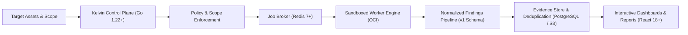
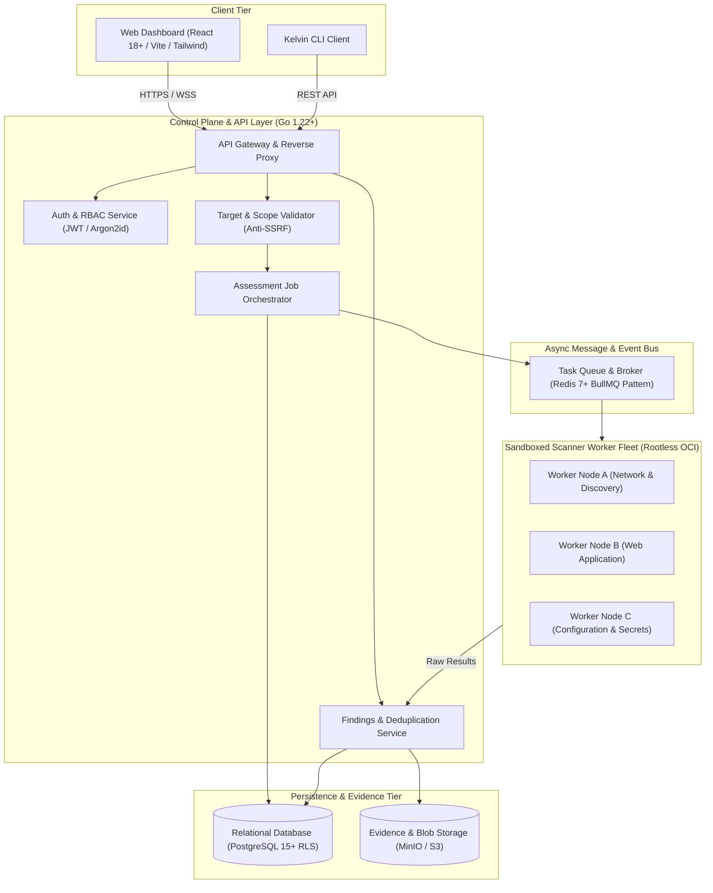
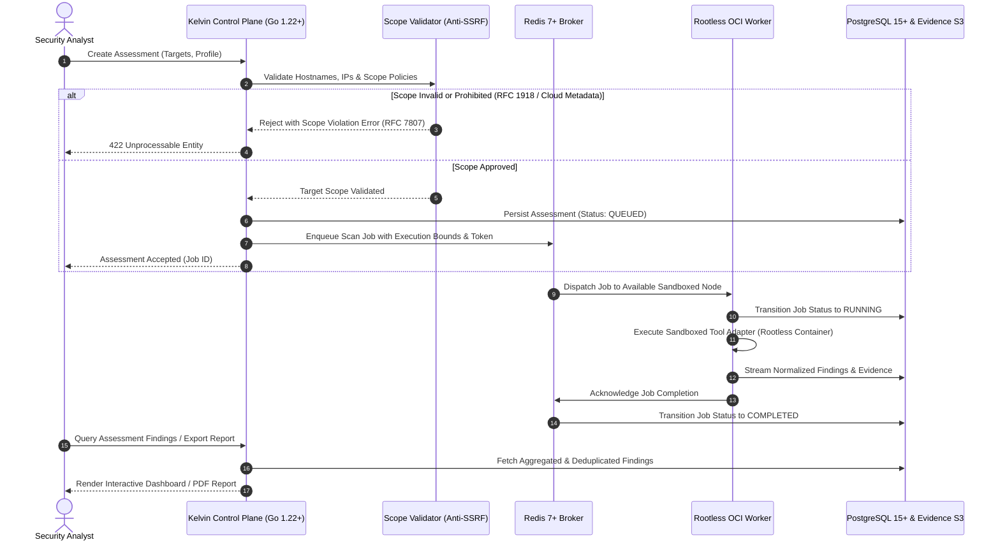
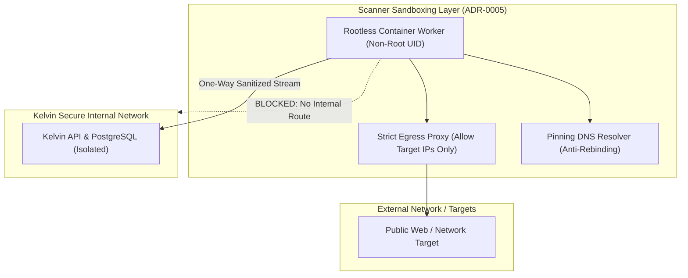

# Kelvin Security Platform — Features & Architectural Design

## 1. Executive Summary & Product Vision

**Kelvin** is an enterprise-grade, modular security assessment and vulnerability management platform designed exclusively for authorized assessments. It provides a unified orchestration environment for asset management, target scope validation, modular scan execution, normalized findings analysis, and executive reporting.

The platform eliminates the fragmentation of running isolated command-line scanners by providing a centralized, policy-enforced control plane and sandboxed execution workers.

---

## 2. Core Feature Matrix

### 2.1 Scope & Target Authorization Engine
* **Strict Scope Validation:** RFC 1918 / loopback / link-local prevention, DNS rebinding mitigations via socket-level DNS pinning, and redirect destination enforcement.
* **Asset Ownership Verification:** DNS TXT record or HTTP challenge verification before aggressive scans.
* **Scan Profiles:** Low-impact passive discovery, standard automated assessment, and authorized deep assessment modes (see [`docs/architecture/SCAN_PROFILES.md`](SCAN_PROFILES.md)).

### 2.2 Modular Scanning & Orchestration
* **Vendor-Agnostic Worker Protocol:** Scanner engines communicate via isolated, standardized CLI/API wrappers.
* **Asynchronous Job Queues:** Distributed task queuing with prioritization, cancellation, heartbeats, and timeout management (Redis 7+ BullMQ pattern, ADR-0003).
* **Process Isolation:** Worker sandboxing running unprivileged rootless OCI containers (ADR-0005) preventing compromised scan targets from executing arbitrary commands or SSRF against host services.

### 2.3 Unified Findings & Evidence Normalization
* **Canonical Vulnerability Schema:** Converts heterogeneous scanner outputs (e.g., OpenVAS, Nuclei, ZAP, Trivy) into standard vulnerability records (`packages/schemas/finding.v1.json`, ADR-0002).
* **Finding Deduplication & Fingerprinting:** Asset + Endpoint + Vulnerability Type fingerprinting to eliminate redundant alerts.
* **Evidence Preservation:** Encrypted storage of raw request/response payloads, screenshots, and proof-of-concept steps with automatic redaction of sensitive credentials.

### 2.4 Multi-Tenant Access & Role-Based Control (RBAC)
* **Tenant Isolation:** Row-Level Security (RLS) policies in PostgreSQL 15+ ensuring zero leakage between distinct enterprise tenants or projects (`docs/security/RBAC_MATRIX.md`).
* **Granular Permissions:** Strict separation between Platform Admin, Tenant Admin, Security Analyst, and Read-Only Auditor roles.
* **Immutable Audit Trail:** Append-only recording of assessment initialization, approvals, target additions, and findings exports in PostgreSQL (zero UPDATE/DELETE permissions).

---

## 3. High-Level System Architecture

Kelvin follows an asynchronous, event-driven micro-modular architecture consisting of five primary tiers:
1. **Presentation Tier:** React 18+ / TypeScript / Vite / Tailwind SPA dashboard (`apps/web`, ADR-0004).
2. **Control Plane (API Gateway & Core Service):** Go 1.22+ standard library `net/http` service enforcing authentication, scope validation, persistence, and audit logging (`apps/api`, ADR-0001).
3. **Message & State Broker:** High-throughput task queue and publish-subscribe state coordinator on Redis 7+ (ADR-0003).
4. **Sandboxed Worker Nodes:** Ephemeral worker containers running modular scan adapters inside rootless OCI sandboxes (`apps/worker`, ADR-0005).
5. **Data & Evidence Storage:** PostgreSQL 15+ with RLS for core entities (ADR-0002) and encrypted object storage for raw evidence blobs.

---

## 4. Logical Data Flow: Scan Lifecycle

The lifecycle of an assessment from target submission to final report generation:

---

## 5. Security & Isolation Architecture

Because Kelvin handles potentially hostile target responses and sensitive assessment findings, the platform implements defense-in-depth principles (ADR-0005, `docs/security/THREAT_MODEL.md`):

1. **Anti-SSRF & Network Boundary:** Scan workers cannot route traffic back to internal infrastructure (`10.0.0.0/8`, `172.16.0.0/12`, `192.168.0.0/16`, `127.0.0.1`, `169.254.169.254`).
2. **Ephemeral Containers:** Each assessment runs inside disposable, rootless container instances with bounded memory, CPU, and execution timeouts.
3. **Data Redaction:** Evidence ingestion pipelines strip authorization headers, cookies, API tokens, and private keys before persistence.
