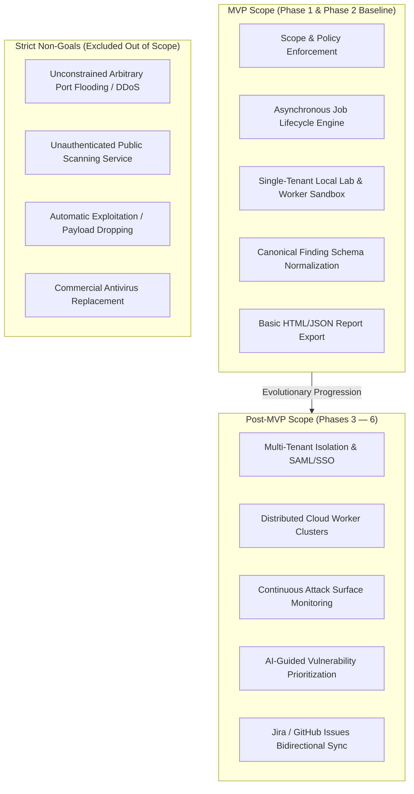
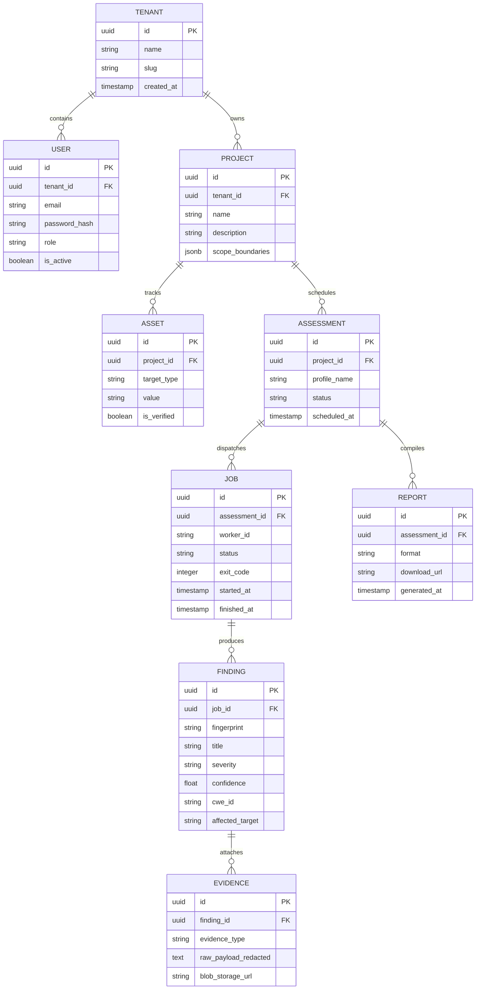
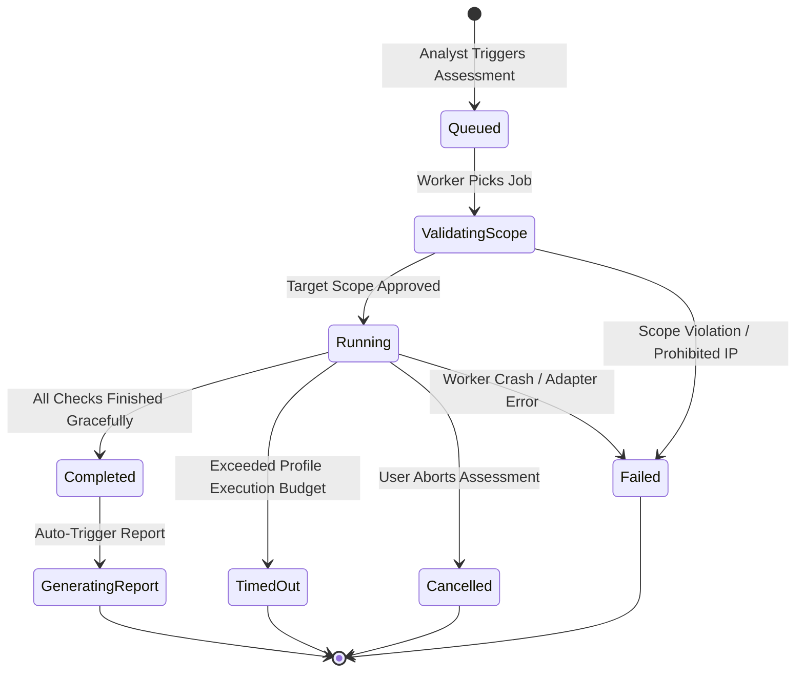

# Kelvin MVP Definition & Phase Bifurcation Framework

## 1. Product Scope Bifurcation

To guarantee rapid validation, operational reliability, and architectural purity, Kelvin explicitly bifurcates product capabilities into three distinct categories: **MVP Core Scope**, **Post-MVP Growth Scope**, and **Strict Non-Goals**.

---

## 2. Core Domain Data Model (MVP ERD)

The relational schema strictly isolates assessment definitions, target scoping, execution jobs, and discovered findings:

---

## 3. Assessment Job State Machine

To prevent deadlocks, race conditions, or unmonitored failures, every assessment job conforms to the following deterministic state transition graph:

---

## 4. Phase-by-Phase Bifurcation & Delivery Criteria

### Phase 1: Foundation & Core Architecture (Current Milestone — 25 Issues)
* **Objective:** Establish unassailable security boundaries, target validation engine, async job state machine, clean repository scaffolding, database persistence, and developer environment.
* **Delivery Artifacts:**
  - `docs/PRODUCT_VISION.md`, `docs/security/THREAT_MODEL.md`, `docs/architecture/`
  - Scope validation engine with strict anti-SSRF and DNS rebinding protections
  - PostgreSQL schema migrations + Redis background job queue abstraction
  - Unified finding and evidence normalized schema contracts
  - 25 tracked foundational GitHub issues

### Phase 2: Engine Integration & Sandboxing
* **Objective:** Containerized execution daemon, pluggable scanner adapter protocol, initial scanners (port/network discovery + web baseline).
* **Delivery Artifacts:**
  - Rootless Docker worker sandbox with locked egress rules
  - Adapter protocol for CLI/JSON vulnerability scanners
  - Real-time job status streaming over WebSocket

### Phase 3: Finding Normalization, Deduplication & Reporting
* **Objective:** Automated deduplication, severity prioritization, credential redaction, and exportable PDF/JSON reports.
* **Delivery Artifacts:**
  - Canonical vulnerability ingestion engine
  - Sensitive token/cookie redaction pipeline
  - Customizable executive and technical assessment reports

### Phase 4: Enterprise Identity & Multi-Tenancy
* **Objective:** Complete organization separation, SAML 2.0 / OIDC integrations, fine-grained access control, and compliance-grade audit logging.
* **Delivery Artifacts:**
  - Row-level database security policies
  - Audit log exporter for SIEM ingestion
  - Enterprise SSO connectors

### Phase 5 & 6: Continuous Automation & Ecosystem Extensibility
* **Objective:** Scheduled recurrence, attack surface diffing, third-party plugin developer SDK, and heuristic risk analysis.
